# 3D AI Programming(2) State Pattern
## 1. 특강
### 1.1. 내용
- Scene 하나를 만든다.
- 애니메이션과 스테이트 패턴을 연동해서 사용한다.
- 이번엔 UI를 이용해서 가볍게 살펴보도록 한다. 
- 하이어라키에 이미지를 만든다.

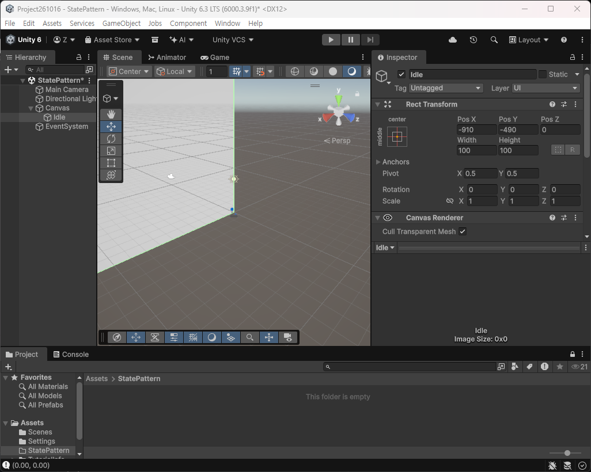

- UI를 다음과 같은 항목으로 수행해준다.

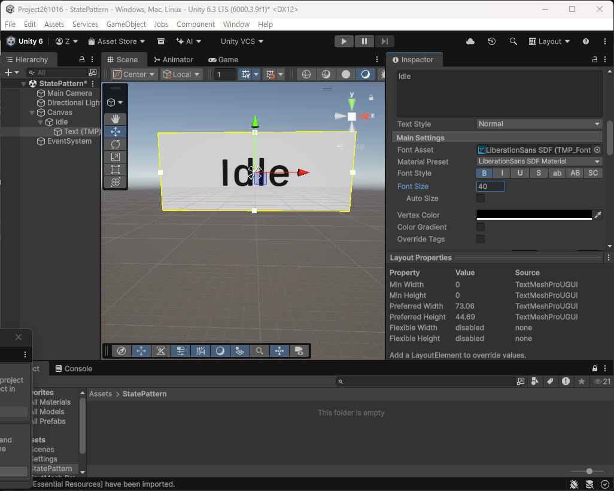

- 이미지 하위에 텍스트를 놓고 가운데 정렬을 하여 준비
- Input Actions를 새로 생성하여 움직임에 대한 것을 복습 차원에서 넣는다. 
- C# 스크립트 하나를 생성해서 PlayerController로 명명 후, 다음과 같이 진행한다.

```csharp
using UnityEngine;
using UnityEngine.InputSystem;
using UnityEngine.UI;

public class PlayerController : MonoBehaviour
{
    [SerializeField] private Vector2 _moveInput;
    [SerializeField] private InputActionReference _moveInputAction;
    [SerializeField] private InputActionReference _jumpInputAction;
    
    [field: SerializeField] public Image _idleImage { get; private set; }
    [field: SerializeField] public Image _moveImage { get; private set; }
    
    private IdleState _idleState;
    private MoveState _moveState;
    private StateBase _currentState;

    private void Awake()
    {
        _idleState = new IdleState();
        _moveState = new MoveState();
    }

    private void Start()
    {
        SetState(_idleState); // 기본 상태
    }
    
    private void OnEnable()
    {
        _moveInputAction.action.Enable();
        _moveInputAction.action.performed += OnMove;
        _moveInputAction.action.canceled += OnMoveStop;
    }
    
    public void OnMove(InputAction.CallbackContext context)
    {
        _moveInput = context.ReadValue<Vector2>();
        Debug.Log(_moveInput);
        
        ChangeState(_moveState);
    }
    
    public void OnMoveStop(InputAction.CallbackContext context)
    {
        _moveInput = context.ReadValue<Vector2>();
        Debug.Log(_moveInput);
        
        ChangeState(_idleState);
    }
    
    public void OnJump()
    {
        Debug.Log("OnJump");
    }

    private void SetState(StateBase state)
    {
        if (_currentState != null)
        {
            _currentState.Exit(this);
        }
        
        _currentState = state;
        _currentState.Enter(this);
    }

    private void ChangeState(StateBase state)
    {
        if (_currentState != state)
        {
            _currentState.Exit(this);
            _currentState = state;
            _currentState.Enter(this);
        }
    }
}
```

```csharp
using UnityEngine;

public interface StateBase
{
    public void Enter(PlayerController playerController);
    
    public void Exit(PlayerController playerController);
}
```

```csharp
using UnityEngine;

public class IdleState : StateBase
{
    public void Enter(PlayerController playerController)
    {
        playerController._idleImage.color = Color.lightGreen;
    }

    public void Exit(PlayerController playerController)
    {
        playerController._idleImage.color = Color.white;
    }
}
```

```csharp
using UnityEngine;

public class MoveState : StateBase
{
    public void Enter(PlayerController playerController)
    {
        playerController._moveImage.color = Color.lightGreen;
    }

    public void Exit(PlayerController playerController)
    {
        playerController._moveImage.color = Color.white;
    }
}
```

## 1. 개요
### 1.1. 상태
- 플레이어가 상태를 하나만 가지리란 보장이 없다. 
- FPS에서 점프하며 피격되거나 총을 쏘는 것을 상태패턴으로 생각해보면 된다.
- 현재 컨트롤러 단에 흡수된 것이면 모르지만 State Machine을 클래스로 분리해서 관리를 한다면 반드시 하나만 가지진 않는다. 
- 병렬 운용이 가능하다는 것이고 쓰기 나름이다.
- 지금은 직렬적인 방식으로 진행할 예정

### 1.2. 상태 패턴의 태동 계기: 예시
- 고블린 경비병을 구현한다고 가정
- 이것을 체계화하는 것이 전제조건
  1) 고블린은 처음에 초소에서 대기한다. 3초 지나면 웨이포인트를 따라 순찰한다.
  2) 순찰 중 마지막 웨이 포인트에 도착하면 다시 대기한다.
  3) 대기나 순찰 중에 플레이어가 시야에 들어오면 추격한다.
  4) 추격 중 공격 사거리 안에 들어오면 공격한다. 공격 한 번이 끝났을 때 플레이어가 아직 사거리 안이면 다시 공격하고, 밖이면 추격한다.
  5) 추격 중 플레이어를 3초 이상 놓치거나 초소에서 특정 거리만큼 멀어지면 초소로 귀환한다.
  6) 귀환 중에는 무적이고 플레이어가 보여도 무시한다. 초소에 도착하면 대기한다.
  7) 귀환 중이 아니라면 기절 공격을 맞았을 때, 2초간 기절한다. 기절이 끝나면 플레이어가 보일 때 추격, 안보이면 귀환한다.
  8) 귀환 중이 아니라면, HP가 0이 되면 사망한다.
- 열거형 금지, Switch 금지, 코루틴 금지.
- 오로지 if문으로만 할 것.
```
bool 플레이어 인식;
bool 공격 가능;
bool 사망 여부;

float 순찰 거리;
float 대기 시간;

GameObject 초소;
GameObject 웨이 포인트;

float 고블린 순찰 속도;
float 고블린 추적 속도;
float 공격 가능 거리;
float 인식 가능 거리;

float 인식 해제 시간;
float 무적 시간;

float 기절 시간;

int 최대 체력;
int 현재 체력;

대기()
{
    플레이어 인식 = false;
    공격 가능 = false;
    사망 여부 = false;

    대기시간; 
}

if(대기시간 <= 0f)
{
    플레이어 인식 = false;
    공격 가능 = false;
    사망 여부 = false;

    웨이포인트의 위치로 이동(순찰 거리);

    if(순찰거리 <= 0f)
    {
        대기();
    }
}

OnTriggerEnter()
{
    
}
```
- 의사 코드는 어디를 고쳐야 할 지 알아보기 힘들다. 
- 이런 느낌을 도식화를 통해 본다면 다음과 같다.

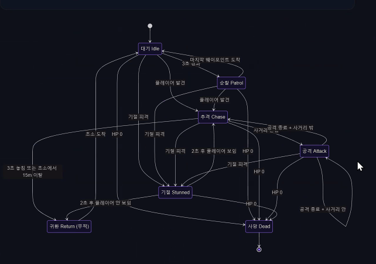

- 여기서 3번 맞으면 기절 해제를 추가할 수 있다. 수도 코드 단에서는 불가했던 사항.
- 어디로 가는지에 대한 경로와 조건, **상태로 묶어놨기 때문**에 보기가 간결해진 셈이다. 

### 1.3. 상태 패턴
- 유한 상태 기계는 상태와 전이로 행동을 나타내는 방식이었다.
- 위 사항에 대해선 상태 기계라고만 인지하고 상태 패턴은 이것을 만들 때 어떤 방식으로 짤 것인가이다.
- 조건들을 나열하고 보았을 때, 고블린의 상태에 따라 무엇을 행동할지 명확하게 되어있었다. 
- 업데이트에서 소스 코드로 구현해야 하다보니 너무 많이 따져야 한다.
- 따라서 **다른 경로로 가는 것을** 어떻게 이어줄 것인가를 생각했을 때는 도식화와 동일하게 가져가며 **State Diagram이라고 부른다**.
- 노드 하나가 객체로써 동작하도록 만들어보자고 접근한 것이 클래스를 쓴 방식이다.
- 상태 패턴의 구조는 다음과 같다.

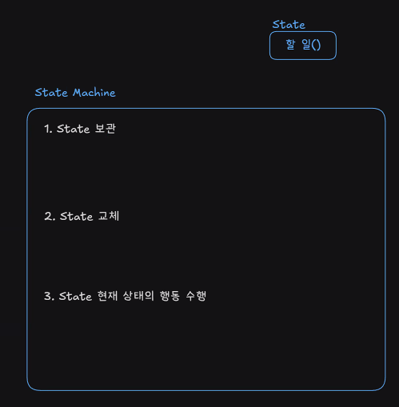 

- 상태를 관리하는 객체를 따로 둔 다음에(각자 할 일은 하도록 설정) 위 3개의 것들이 존재해야 한다.
- 다음과 같이 수정하고 보도록 하자.

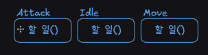

- 스테이트 머신 단에서 보관한다.

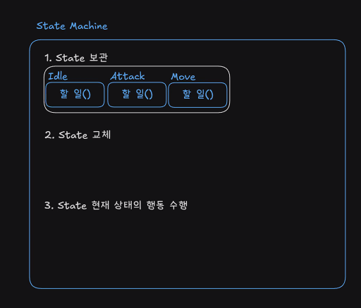

- 그러면 맨 처음 초기화 시 할 일은, 초기 상태에 대한 준비를 해줘야 한다. 
- 현재 상태를 준비하고 보관하던 State를 넣어준다. 그리고 현재 상태를 수행시킨다.

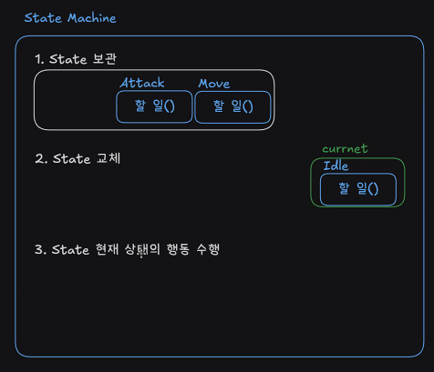
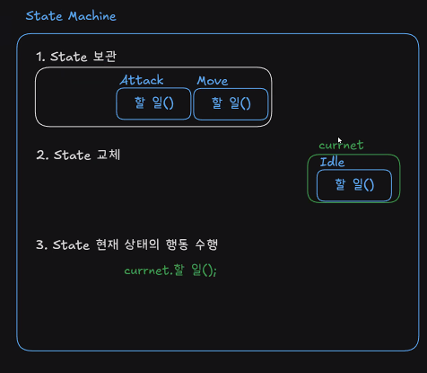

- 1번, 3번은 끝났다. State 교체가 일어난다고 한다면 바꿔 끼워준다.

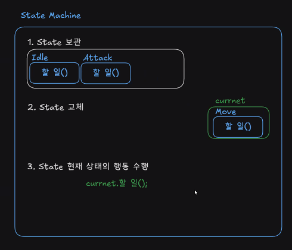

- 3번은 다시 수행된다. 이런 느낌이다.

### 1.4. 적용
- 컨트롤러와 스테이트 머신을 별개로 둔다.
- 일단 InputActions를 수정

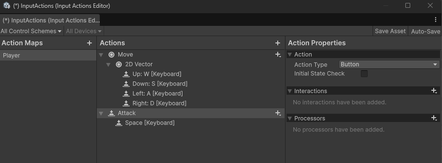

- 스크립트 2개 생성

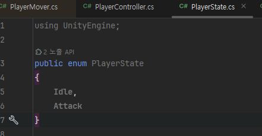
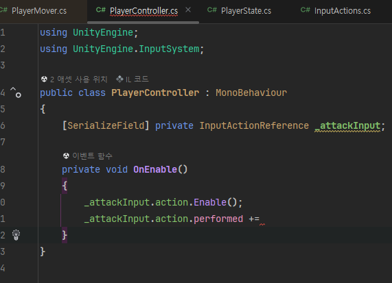

- 함수 추가 및 걸어주기

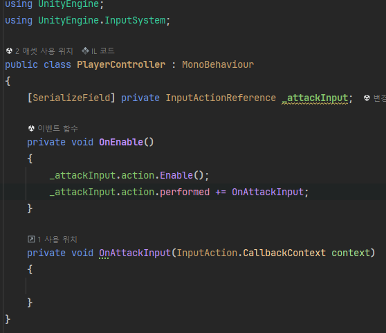

- 업데이트에서 모든 조건 체크가 아닌 지금 현재 상태에 따라 다르게 행동하도록 하자.

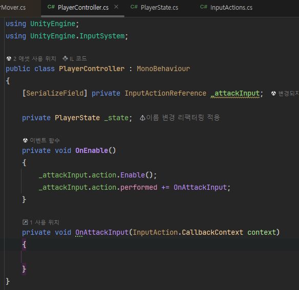

- 키가 눌렸으면 상태를 바꿔주고

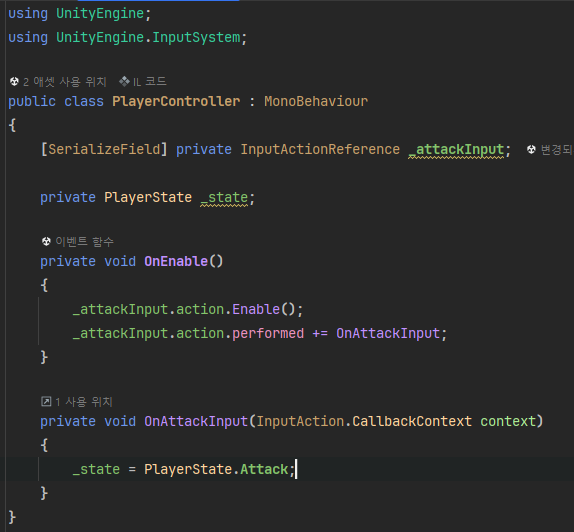

- 그리고 Update에서는 이런 식으로 받는다.

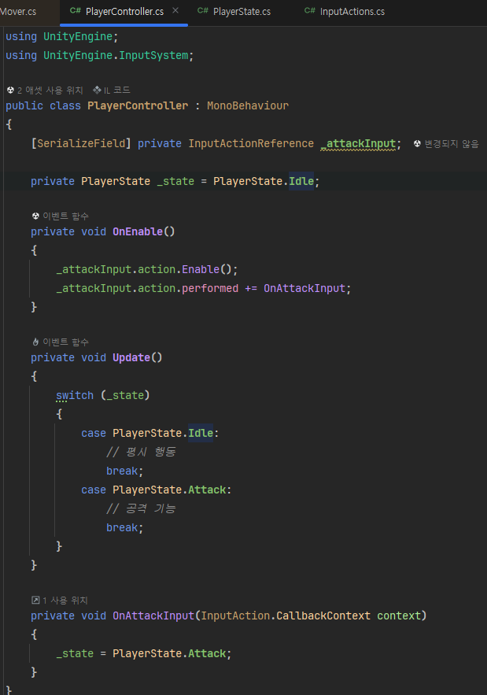

- 상태를 한 줄로 빼도록 하자. 그리고 switch case에 적용.

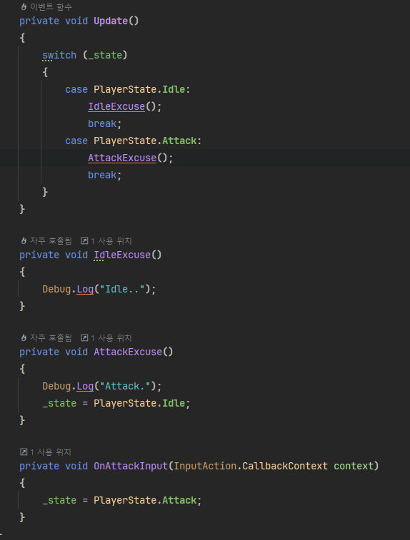

- 직관적으로 상태로 갖다가 관리하는 차원에서는 상태를 객체로 만들어가며 해도 무방하다는 것.
- 클래스화는 오버 엔지니어링이 될 수도 있다는 이야기.
- 이것이 유한 스테이트 머신이다.
- 키가 눌렸을 때, PlayerState가 바뀌고 공격 로그가 그 때만 나와야 한다.

### 1.5. 응용
- 열거형 말고 이번엔 추상 클래스로 진행할 것이다.

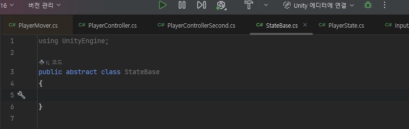

- StateBase들을 상속받은 쪽에서 객체가 생겨야 하지 이것으로 객체를 생성하면 안되기에 막음.
- 내부에 다음과 같이 생성

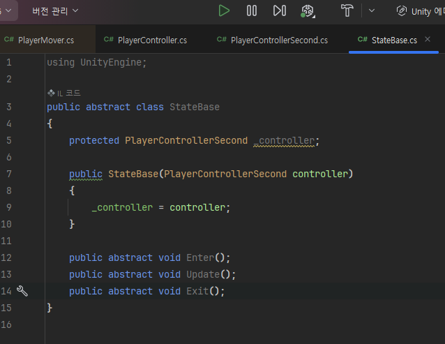

- 이제 이것을 상속받을 클래스를 만들어야 한다. 

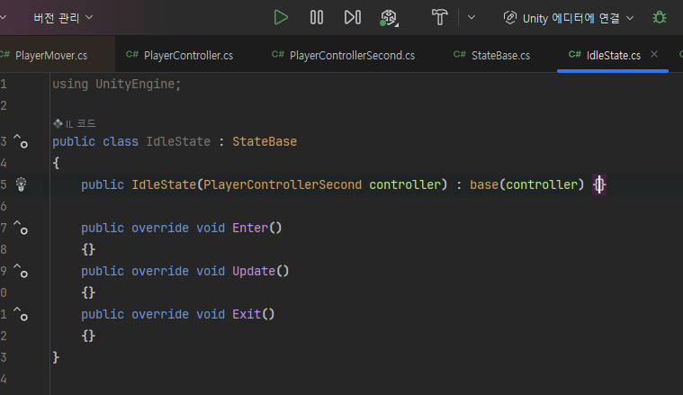

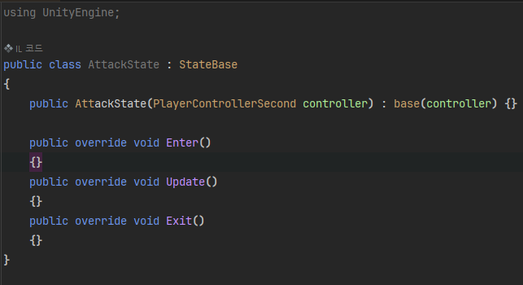

- 아까 인터페이스와 비교해봤을 때 별거는 없다. 
- 추상 클래스를 통해 구현하는 때에는 말단부는 이렇게 처리도 해준다. 

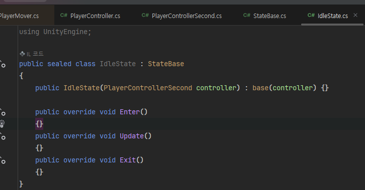

- 이제 스테이트 머신을 통해 자동으로 호출되도록 할 것이다. 
- 바뀌어야 하는 상태면 Exit이 호출되고 바뀌어야 한다.

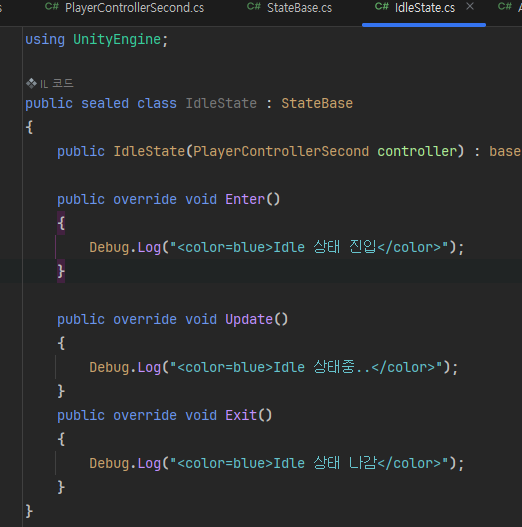

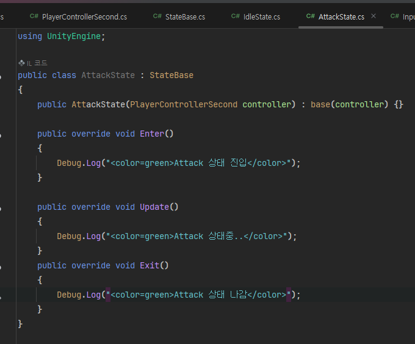

- Attack이 눌리면 Attack 상태로 변경해야 한다.
- 이것을 타고 호출이 되게끔 해야 한다.

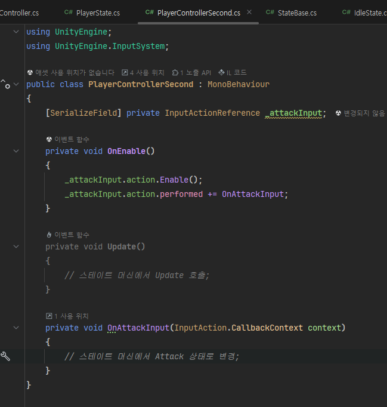

- 스크립트 StateMachine 추가

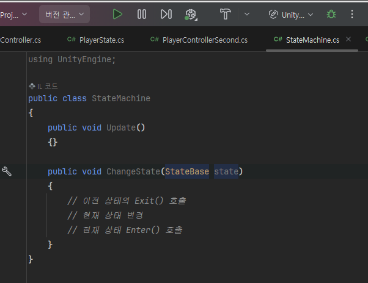

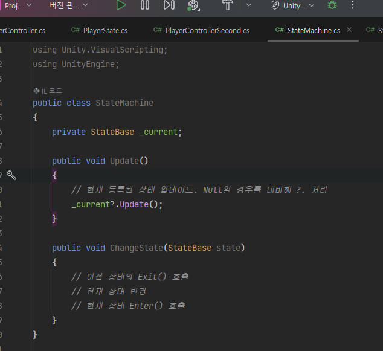

- 다시 돌아와서 해당 내용을 추가한다.

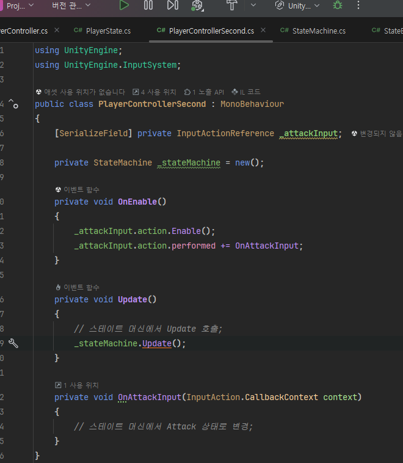

- 현재 구조 자체는 사건이 있었을 때, 상태 변경만 해주고 Update에서는 모르지만 Update를 명령한다. 
- 각각의 State를 들고 있는 형태가 있었는데 그것대로 해보면

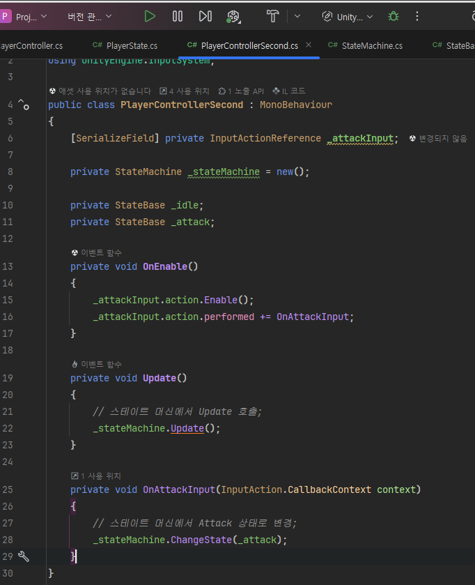

- ChangeState가 구현된 상태라면 돌아간다. 
- 그렇다면 초기화 단계에서 객체를 가지도록 해보자.

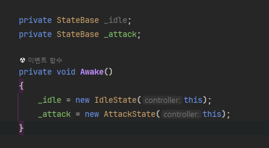

- 변수들의 객체가 할당되어 있을 것이고 ChangeState로 전달이 될탠데 이 부분을 구현해야 한다.

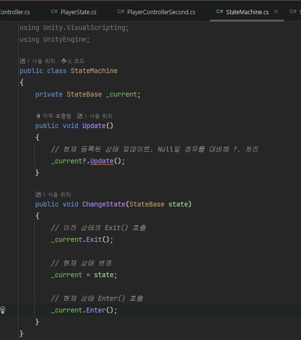

- 현재의 상태를 그림으로 나타내면 다음과 같다.

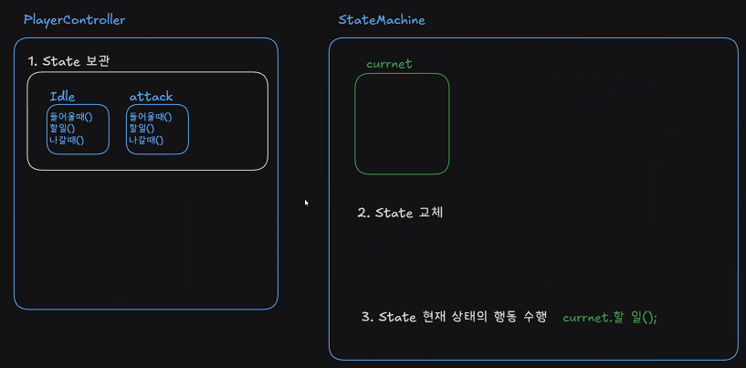

- PlayerController가 StateMachine을 불러주고 있는 형태이다.
- 컨트롤러 단에서 교체해달라고 요청이 들어오면서 Idle에서 Exit() 호출, Attack으로 교체, Attack의 Enter() 호출의 상황.
- 입력받은 State가 Null이거나 _current와 State가 같다면? 그리고 _current가 Null이라면? => 대비가 필요하다.

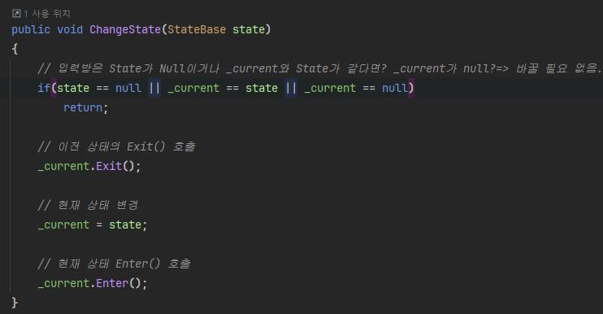

- 맨 처음 구성할 때는 _current가 null일 수 있다. 최초 상태를 받아다 미리 세팅하거나 최초 생성 시에는 호출이 안되도록 하던가 둘 중 하나를 취사 선택하면 된다. 
- 컨트롤러 Awake 단에서 최초 상태를 넣어주는 것으로 진행해보도록 하자.

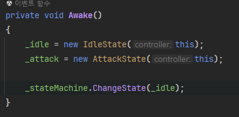

- 이것을 좀 더 응용해보도록 하자. StateMachine에 Monobehaviour를 다시 붙여서 컴포넌트에 붙일 것이다. 
- 그리고 인터페이스를 만들자.

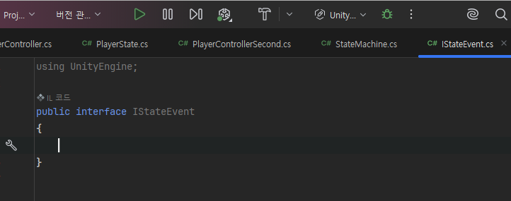

- 여기서 다음과 같이 구현한다. 

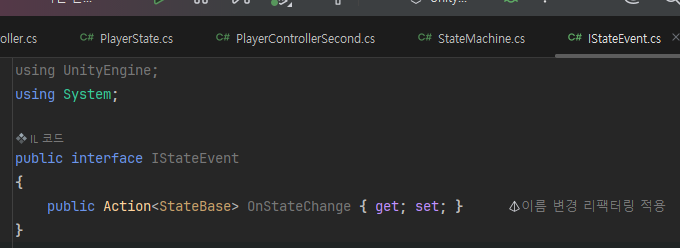

- 그리고 PlayerController에서 이 인터페이스를 구현하자.

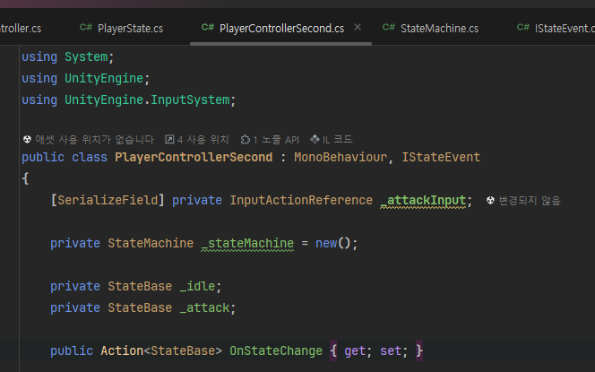

- 그리고 StateMachine을 지운다.

```csharp
using System;
using UnityEngine;
using UnityEngine.InputSystem;

public class PlayerControllerSecond : MonoBehaviour, IStateEvent
{
    [SerializeField] private InputActionReference _attackInput;

    private StateBase _idle;
    private StateBase _attack;

    public Action<StateBase> OnStateChange { get; set; }
    
    private void Awake()
    {
        _idle = new IdleState(this);
        _attack = new AttackState(this);
    }

    private void Start() => OnStateChange?.Invoke(_idle);
    
    private void OnEnable()
    {
        _attackInput.action.Enable();
        _attackInput.action.performed += OnAttackInput;
    }

    private void OnAttackInput(InputAction.CallbackContext context)
    {
    
        OnStateChange?.Invoke(_attack);
    }
}
```

- 이제 다음은 캐싱해준다.

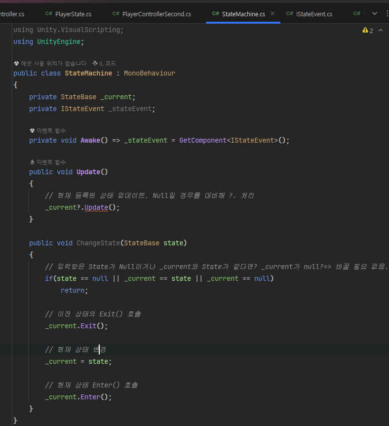

- 걸도록 하자.

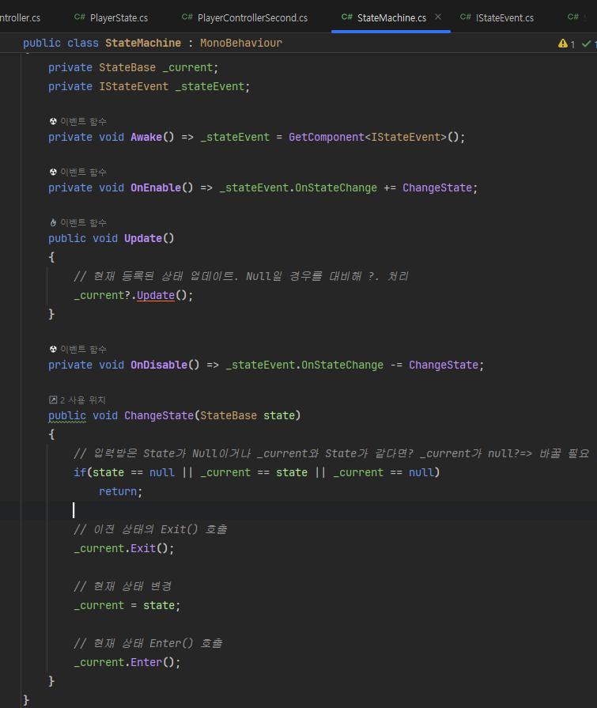

- 과정 자체는 테스트하면서 보도록 할 것. 
- public으로 열어둔 Action 이벤트를 통해 StateBase를 매개 변수로 가진 것을 델리게이트를 구현하도록 만든다.
- StateMachine은 변수에 담은 다음, 이벤트에 ChangeState를 걸어두고 해제하는 것이 있다. 
- PlayerController 단에서는 IStateEvent 인터페이스를 받아 구현이 이뤄져야만 하고 Start 단에서 반응하면 실행되도록 하는 것을 걸어주고 마찬가지로 Attack 키를 누를 때도 Action 이벤트 기반으로 상태를 바꿔준다. 

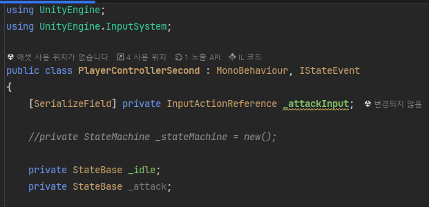

- 위 부분을 이제 외부에서 가져갈 수 있도록 설정한다.

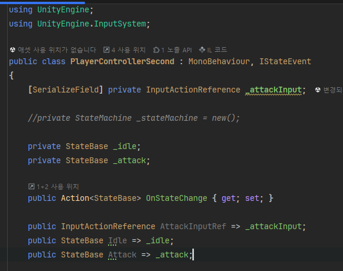

- 외부에서 PlayerController 쪽에다가 상태 변경을 요청할 수 있도록 해보자.

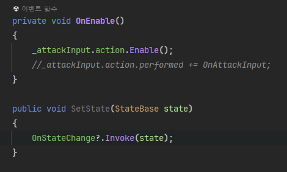

- 이렇게 한 다음, IdleState, AttackState를 살펴보자.
- Idle에서 Attack으로 가기 위한 조건은 Attack키가 눌려야 한다.

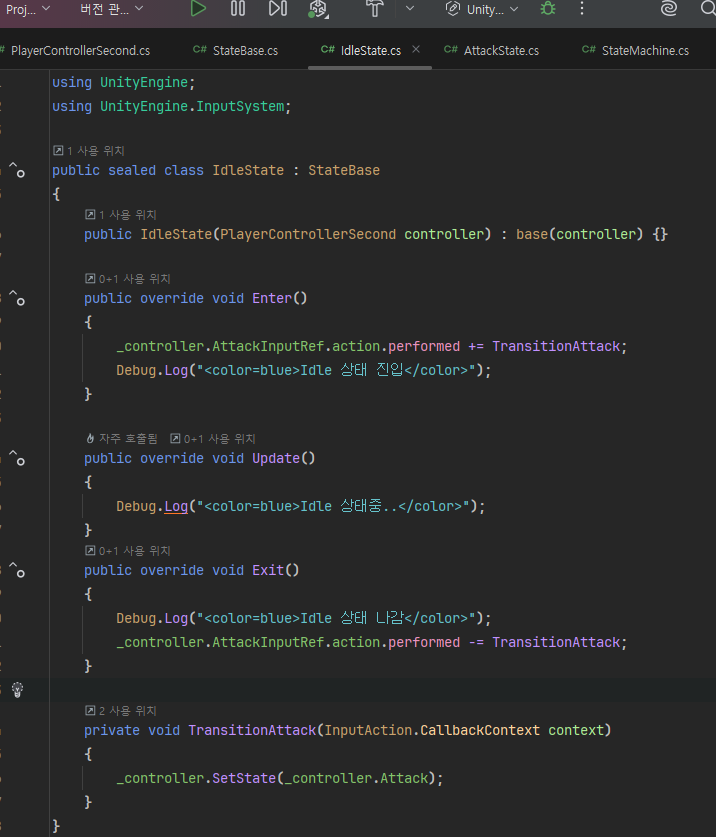

- Attack에서 idle로 가기 위한 것은 Attack이 끝났을 때이다. 

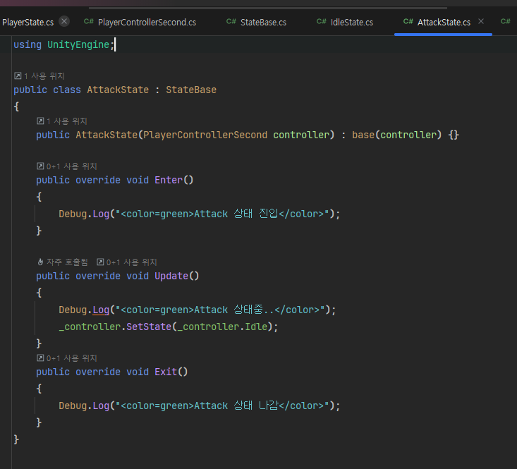

- 이제 컨트롤러 단에서는 뭔가 없기는 하다.
- Damage를 추가하자.

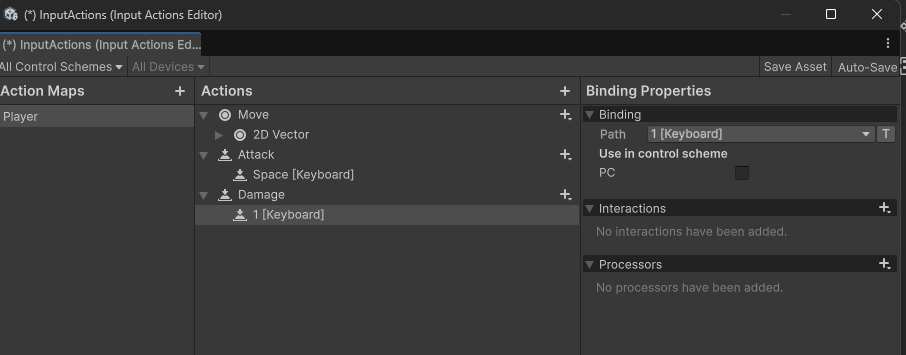

- 컨트롤러 단에 주고 다른 State 생성.

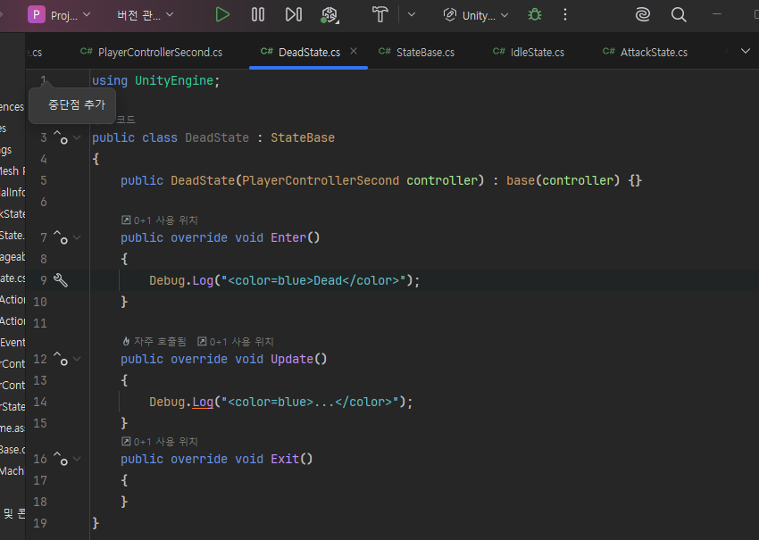

- 컨트롤러에 변수 선언

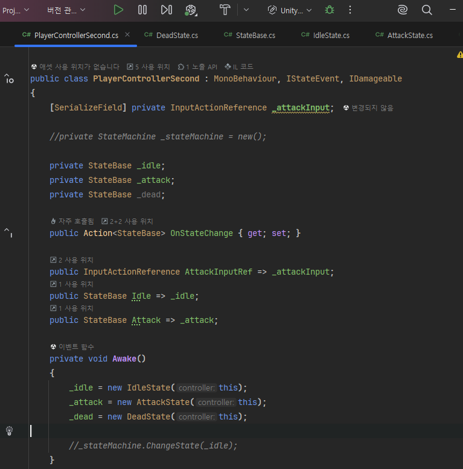

- 어느 상태에서건 들어갈 조건이라면 Controller 쪽에서 직접 죽여도 상관없음.

```csharp
using System;
using UnityEngine;
using UnityEngine.InputSystem;

public class PlayerControllerSecond : MonoBehaviour, IStateEvent, IDamageable
{
    [SerializeField] private InputActionReference _attackInput;
    [SerializeField] private InputActionReference _damageInput;
    //private StateMachine _stateMachine = new();

    private StateBase _idle;
    private StateBase _attack;
    private StateBase _dead;

    public Action<StateBase> OnStateChange { get; set; }

    public InputActionReference AttackInputRef => _attackInput;
    public StateBase Idle => _idle;
    public StateBase Attack => _attack;

    private void Awake()
    {
        _idle = new IdleState(this);
        _attack = new AttackState(this);
        _dead = new DeadState(this);

        //_stateMachine.ChangeState(_idle);
    }

    private void Start() => OnStateChange?.Invoke(_idle);

    private void OnEnable()
    {
        _attackInput.action.Enable();
        _damageInput.action.Enable();

        //_attackInput.action.performed += OnAttackInput;
        _damageInput.action.performed += OnDamageInput;
    }

    public void SetState(StateBase state)
    {
        OnStateChange?.Invoke(state);
    }

    private void OnDamageInput(InputAction.CallbackContext context)
    {
        TakeDamage(1);
    }

    public void TakeDamage(int damage)
    {
        // 원래라면 체력 깎기

        // if (체력 <= 0)
        OnStateChange?.Invoke(_dead);
    }
}
```

- 등록 절차

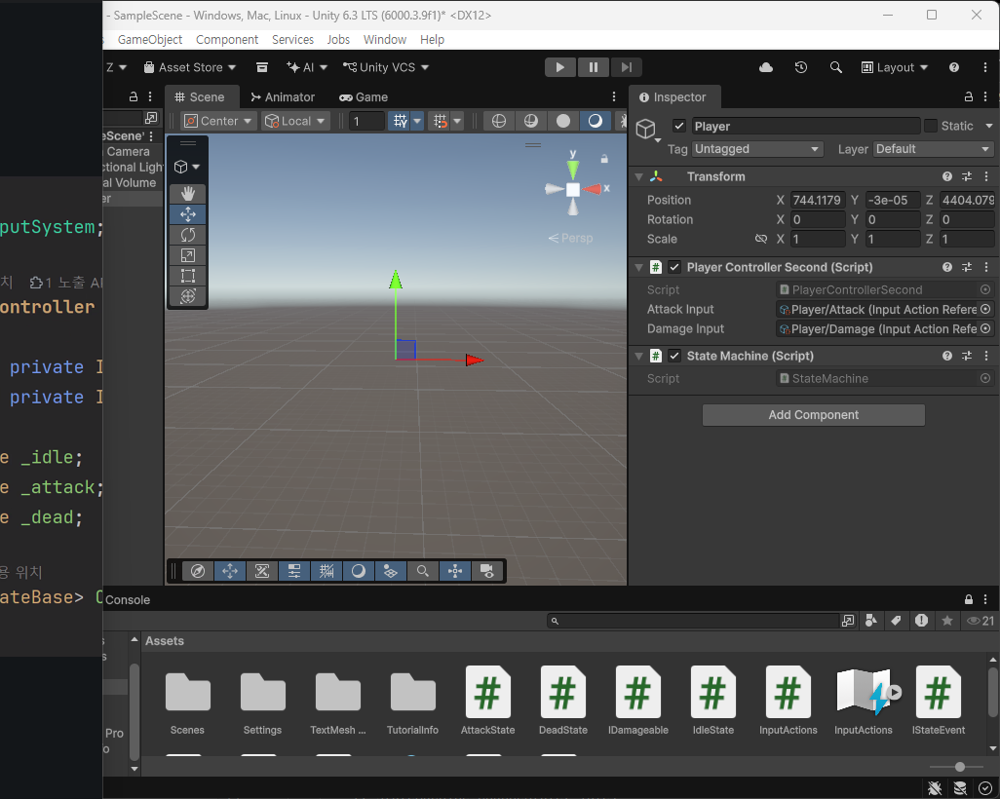

- 플레이어는 어떤 상태를 가지고 있어야 하는지 알고 있고 반응할 키입력 활성화 처리 후, Start에서 Idle만 하고 아무것도 안한다. 
- Idle 상태 진입 순간부터 전이될 조건을 건 상태. 상태 내부에서 판단할 수 있게 된다. 
- 상태 클래스 추가하고 컨트롤러에서 제어가 아닌 상태 자체가 자신을 알도록 해야 한다. 
- 키가 눌려 함수 호출 시, Controller의 SetState에서 Attack 상태로 변경되고 호출되는 형식.

- IStateEvent만 구독하면 어디든 갖다가 써도 된다는 의미. 

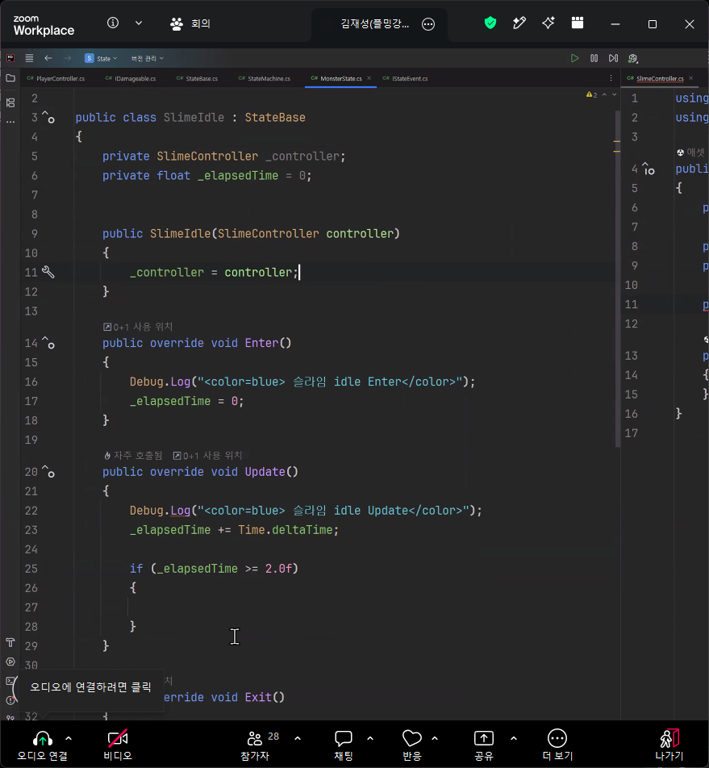

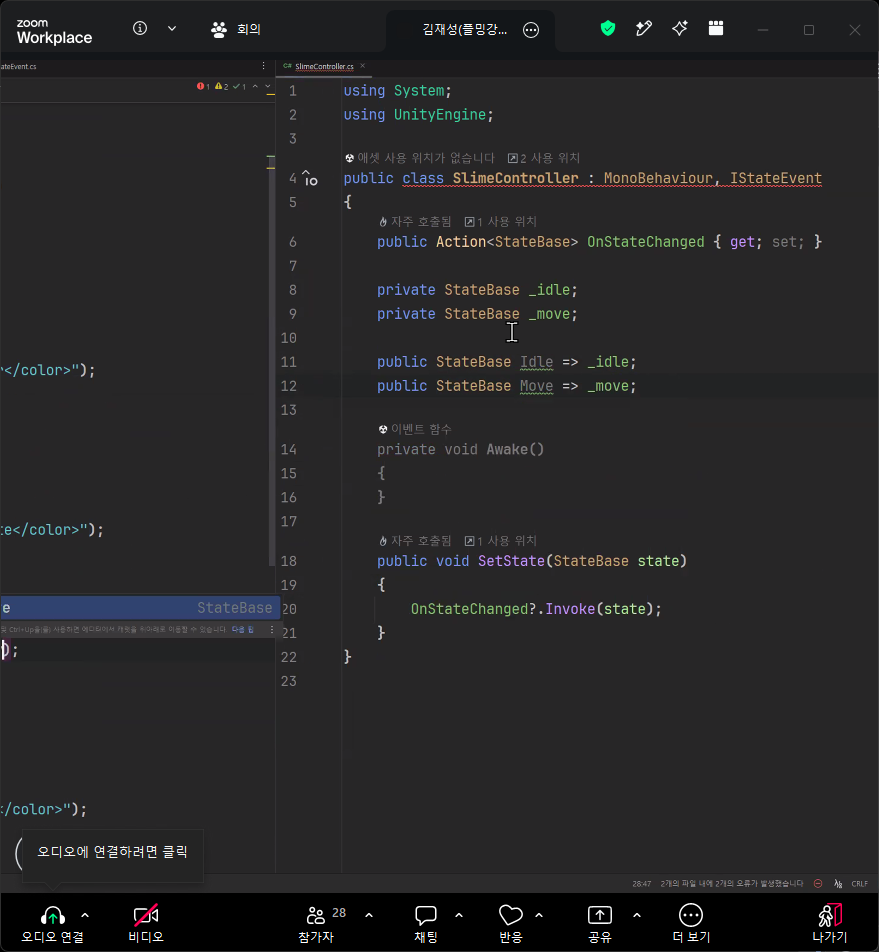


- 스테이트 머신 입장에서는 어떤 게임 오브젝트에 붙어있는지 신경쓰지 않고 원하는 인터페이스만 있으면 돌아간다. 
- 사실상 상태 추가 규칙만 잘 지키면 어떤 종류의 몬스터던 뭔들간에 상태를 유지할 수 있다.
- 만일 이 객체가 컨트롤러 단에서 스테이트 머신을 필요로 한다면 Require도 걸어주면 된다.


- 다만, OnEnable에서 활성화되었다면 비활성화 때 차단해주는 방어적 코드 요소들은 알아서 설정할 것.