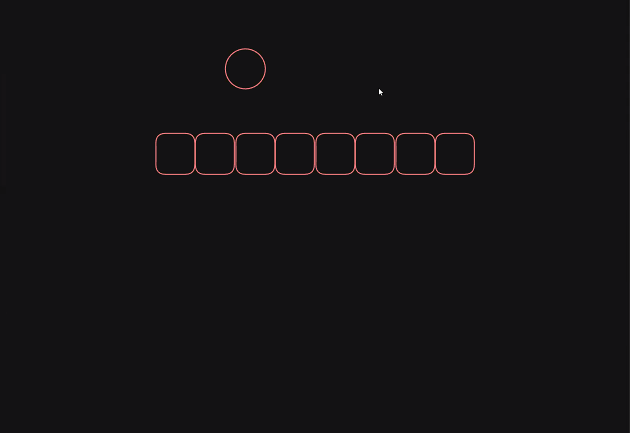
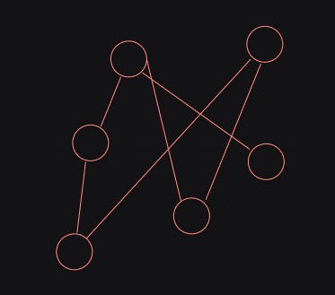
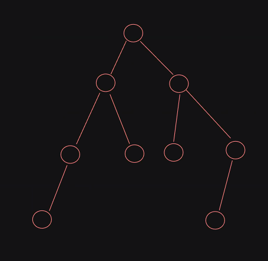
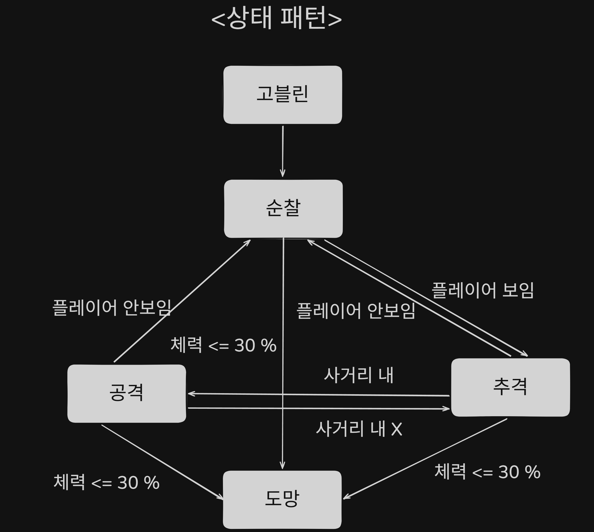
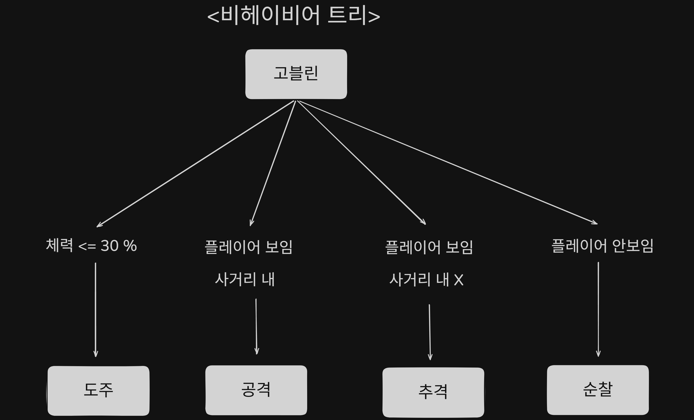

# 3D AI Programming(3) 비헤이비어 트리
## 1. 비헤이비어 트리
### 1.1. 개요
- 이렇게 나열된 것은 선형 자료구조이다.

- 더해서 순차 자료구조이다.
- 그런데 예를 들어 이런 형태라면 그래프였다.

- 어떤 노드가 어디를 연결할까가 핵심이었다. 
- 다음과 같은 구조는 트리였다.

- 일정한 규칙은 생기는데 특정 노드의 부모는 하나일 것이며 순환이 안되는 룰이 존재한다. 
- 비헤이비어 트리도 이러한 형태의 도식화가 되고 기본적인 원리 자체는 시작점에서 할 수 있는지에 대한 질문의 연속이 된다. 로직의 흐름이 결정되는 구조는 그렇다.
- 예를 들면 타겟과의 거리? 발견? 등에 대한 방사를 해놓고 돌리니 타고 들어가다가 조건에 부합하면 행동을 한다는 것이 기본적인 비헤이비어 트리의 느낌이다. 

### 1.2. 상태패턴에서의 한계
- 상태 패턴 때는 상당히 명확했다. 
- 조건이 얽히고 섥혀서 맨 위에서와 아래까지 봤어야 했다. 그런데 클래스로 묶으니 기준이 명확해지고 로직이 컨트롤이 쉬웠다. 
- 컨트롤러 단에서도 현재 상태 기준으로 메서드 호출이 전부였다. 
- 그런데 상태 패턴으로도 조절이 힘들 경우가 존재하게 되는데 조건 전환이 상대적 용이함이 있다. 
- 디자인 패턴 등을 이용할때와 마찬가지로 불편함을 느껴야 하는 사항이다.

### 1.3. 트리

- 데이터 하나하나를 노드, 규칙에 따라 가장 최상단에 있는 것을 루트 노드, 가지 형식으로 퍼지니 부모, 자식, 형제 개념이 존재한다.
- 최하단은 리프 노드라고 한다.
- 자료구조나 알고리즘, CS들은 키워드를 아는 것이 힘이다. 
- 자신에게 누적시켰을 때, 말이 용이해진다. 
- 어떤 키워드를 써서 패킷에 대해 설명이 용이하다는 것.
- 기본 전제는 밑의 것이 성공했는지에 대해 생각을 해야 한다. 
- 전의 것이 성공이더라도 밑의 것이 실패면 최종 실패이다.
- 성공, 실패, 실행중으로 노드 결과는 나뉜다. 
- 조건의 충족에 대한 이야기일 뿐이다. 
- 행동에 대한 판단을 할 때 쓰인다. 
- 상태들에 대한 관리 방식이 다르다는 것. 상태 패턴은 바로 전이고 비헤이비어는 조건 검사를 하면서 간다는 것이다. 
- 사실상 비헤이비어 트리로 짠 로직은 이미 도식화가 되어 있는 셈이다. 
- 유니티도 트리 방식으로 비헤이비어 그래프를 통해 조건 걸어서 쓸 것이다. 
- 고블린의 행동 방식에 대한 도식화를 통해 상태 패턴과 트리의 예시는 다음과 같이 볼 수 있다. 

