# 3D AI Programming(4) NavMesh
## 1. 
### 1.1. 개요
- 모든 기술이 그렇지만 탐색 알고리즘을 돌리는 것이 더 안 좋을 수 있다.
- 몬스터가 1,000마리가 경로 탐색을 한다는 것은 비효율이다. 
- 그래서 지금까지는 Transform으로 이동시키다 보니까 막힌 벽이나 장애물, Runtime 중의 장애물에 의해 막힌다.
- 디펜스 게임은 Waypoint나 그런 것을 통해 이동했을탠데 구현 환경에 적합한 것은 정해져있을 것이다.
- 기본적으로 NavMesh가 어떻게 돌아가는지 알 수 있을 것이다. 
- bake된 Map을 통해서 실습 위주

### 1.2. NavMesh

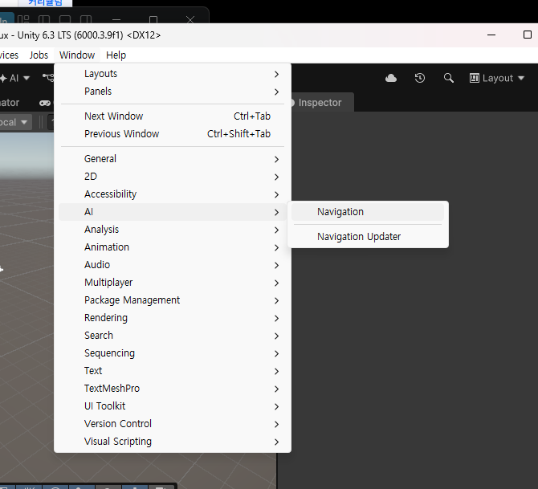

- 이것을 통해 들어가면

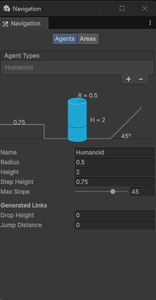

- 이런 형식으로 발생. 
- 직관적인 것이 NavMesh는 이동 주체가 원통형으로 표시가 되고 지나갈 수 있는 경사라던지 건너갈 수 있는 계단형 지형(문턱) 등을 설정하고 맞춰서 이동 맵을 만들 수 있다. 
- 그래서 Ground와 wall을 설치하자.
- Player라는 Capsule과 Layer를 설정한다.

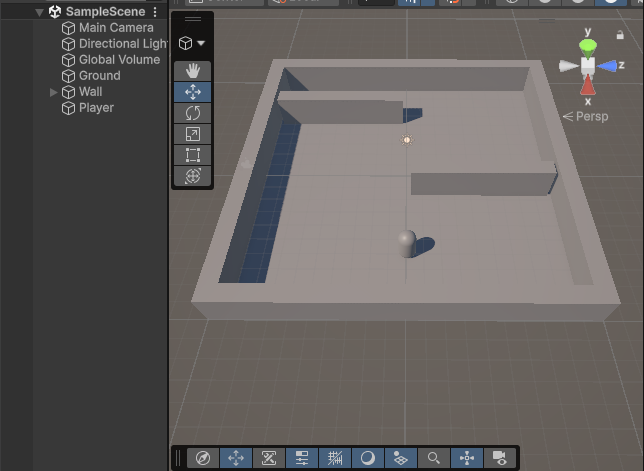

- 대부분 스크립트 상의 Update 단에서 이동을 담당했었는데 근본적으로 이동한다는 것은 앞으로 밀어주는 것이지 길을 찾아간다는 것은 아니었다. 
- Ground를 선택하고 컴포넌트 중, NavMesh Surface를 추가한다.

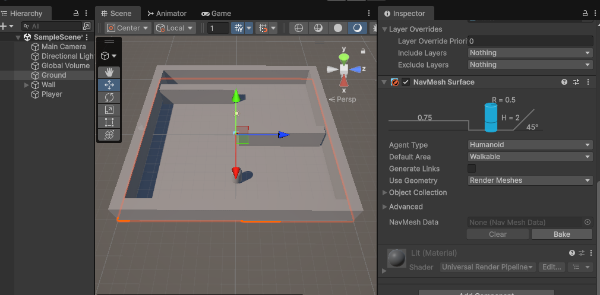

- 그러면 아까 봤었던 NavMesh에서 몸체에 대한 설정을 확인할 수 있다. 
- 버전업을 하면서 설정 방식과 과정이 바뀌었다. 
- 기존 레퍼런스를 통해서 구버전 사용법은 확인하면 된다. 
- 하여튼 NavMesh Surface를 살펴보면 Bake라는 버튼이 있는데 말그대로 맵을 굽는다. 
- 런타임 중에 찾으면 부하가 크므로 어느정도 찍어놓고 움직이는 방식이다. 
- Object Collection도 확인할 수 있다. 모든 오브젝트를 해당사항에 둘 것인지 특정한 Layer만 설정할 것인지를 한 것이고 아까 설정한 것이 그 이유이다. 
- Ground로 두고 Bake하면

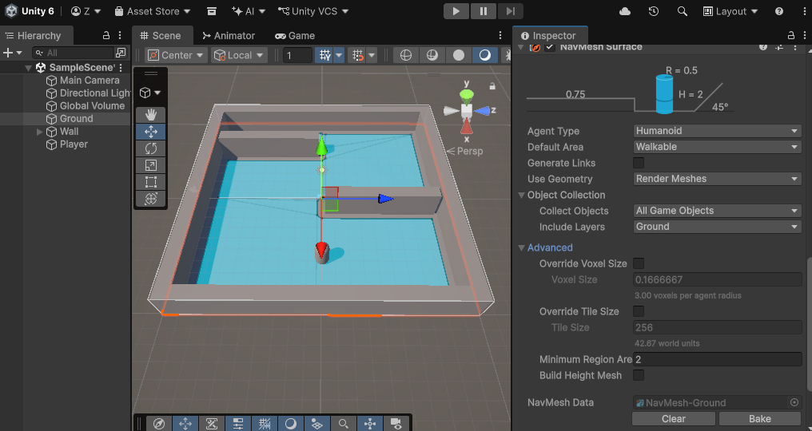

- Sphere 등으로 도착지점을 추가하고 PlayerMovement라는 스크립트를 생성한다.

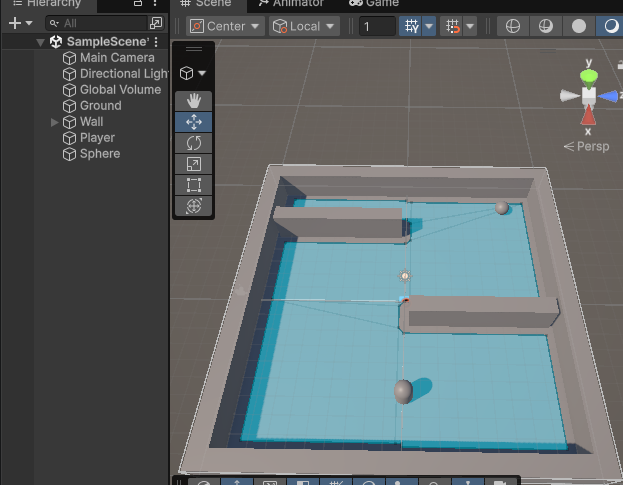

- 일단은 NavMesh를 생각하지 않고 마우스 클릭 -> 클릭한 곳의 좌표 받아서 이동하기(Ground 위에서만)를 구현해볼 것. 
- 진행을 했다면 현재 상태는 이동만 하므로 벽을 통과해서 간다. 
- 애초에 Suface 상에서 Player만 빼고 전부 선택한다면 다음과 같이 된다.

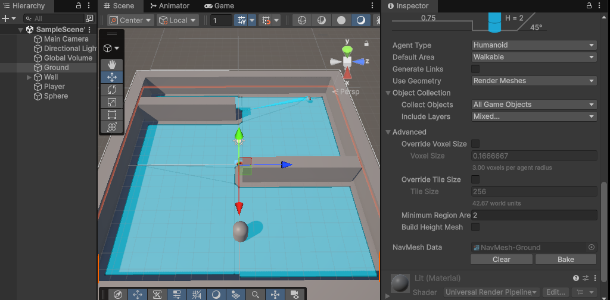

- 파란색 경로가 NavMesh에서 설정했을 때 아바타 크기를 염두해두고 지정을 한 것이다. 
- 만일 Radius를 조절하여 영역을 설정할 수 있다. 
- 이렇게 하더라도 벽을 통과할 것이다.
- 이동 처리는 MoveToward를 적용했기 때문인데 Navigation이 적용되게끔 만들어야 한다.
- 플레이어에 Nav Mesh Agent를 추가한다

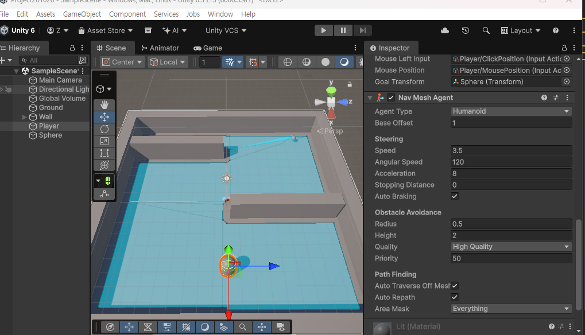

- 이제 붙여줬으니 컴포넌트 받아오는 쪽에서 설정해야 한다. 

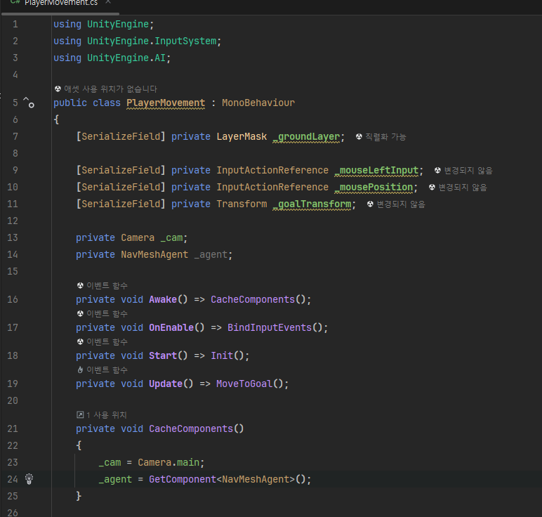

- 설정해주고 다음과 같이 수정

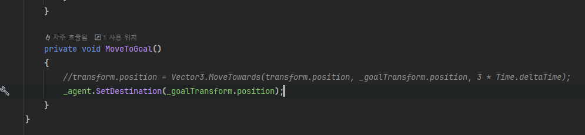

### 1.3. 응용
- 이런 지형으로 만들고 Bake를 뜰 것.

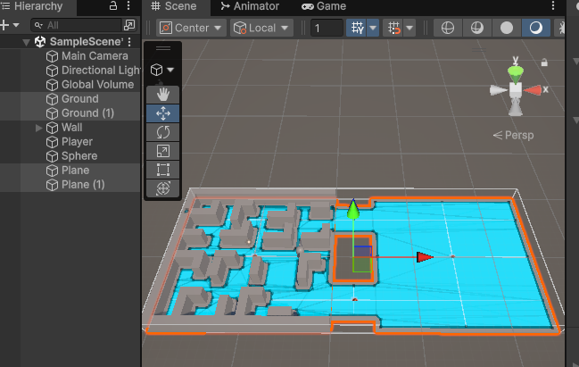

- 이런 상황이면 Agent가 이동할 때, 알아서 갈 것이다. 

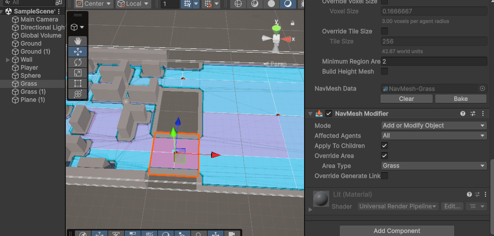

- 피해서 가려고 함.

- Nav Mesh Obstacle의 경우는 딱히 Bake를 뜨지 않아도 가능해진다.

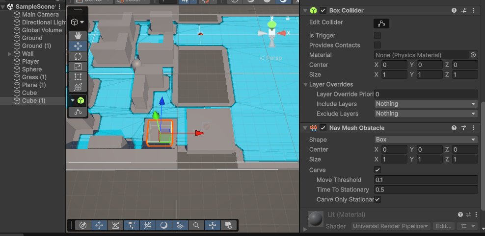

- 하지만 이 경우는 남용해서 쓴다면 성능상의 문제를 일으킬 수 있기에 자제하도록 한다.
- Nav Mesh Link는 소위 오르막길 다리 역할을 해준다. 

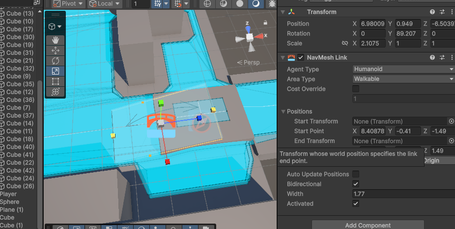

### 1.4. 내부적 요소
- 대각선이 많이 그려진 것을 볼 수 있는데 이게 전부 그래프이다. 
- 내부적으로는 A* 알고리즘을 돌린다는 이야기이다. 
- 선분 하나가 다른 노드로의 이동이다. 

### 1.5. 한계
- 심리스를 적용한 무한 맵일 경우는 길찾기 알고리즘을 직접 구현해야 한다.
- 플레이어가 영역 쪽으로 갔다면 다음 노드를 미리 로드를 해야 함. 