# 3D AI Programming(5) SVC
## 1. 사전 준비
### 1.1. 구글 스프레드시트 생성
- 구글 스프레드시트를 하나 생성한다. 

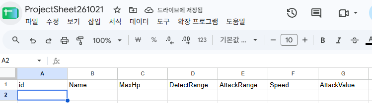

- 몇번째 칸에 몇번 데이터를 읽도록 한다가 골자이다.
- 그런데 데이터를 중간에 끼워넣는다고 한다면 테이블 구조 전체를 바꿔야 할 수도 있다. 
- 일단, 4가지 정도로 설정해서 진행하자.

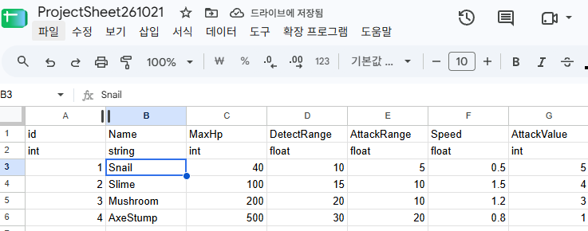

- CSV는 쉼표로 구분된 형태로 저장된다. 
- TSV는 콤마가 들어가는 string을 예시로 든다면 이상하게 나눠지므로 TSV 쪽을 추천은 한다. 
- 그래도 콤마로 하는 것이 직관적이므로 CSV로 진행할 것. 

### 1.2. 파일 생성
- 파일/다운로드/CSV로 다운을 받을 것.
- 일단 엑셀이 아닌 경우에는 다음과 같이 발생

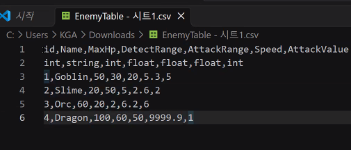

- 그래서 Visual Studio Code에서 Rainbow CSV를 받아 설치한다. 

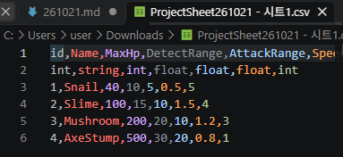

- 이제 데이터 뽑은 것을 심으면 되는 것인데 어떤 과정을 거치는 것인지를 생각하면 된다. 
- 사람이 보기엔 일정 데이터 부분을 찍어 가져가면 될 것. 

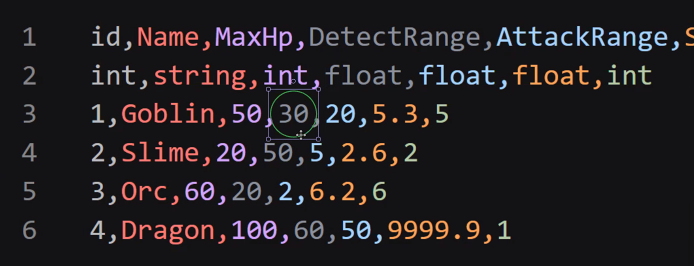

- 사실상 CPU 입장에서는 이 모든 것이 한 줄이고 문자열로 전개되어 있다. 
- 첫번째로 줄을 나눠줘야 한다. 
- 나누는 방법은 개행문자를 기준으로 줄을 나눌 것이고 결과물은 string[]로 나올 수 있을 것이다. 
- 두번째는 줄들을 순회돌면서 콤마를 기준으로 나눈다. 
- 이것도 역시 string[]이 나온다. 

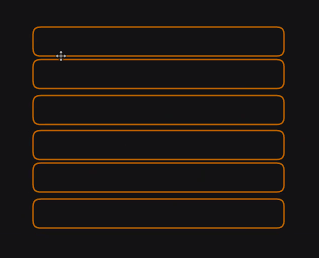

- 이렇게 나눈 단위에서 string[]으로 콤마 단위로 다음과 같이 나뉜다. 

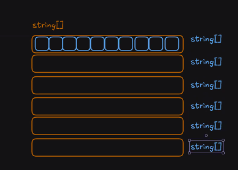

- 결국 2차원 배열과 흡사하게 접근만 하면 된다. 
- 줄로도 나누고 콤마별로 string을 나눴으니 접근하면 뽑아낼 수 있다. 
- split 2번 사용하면 바로 적용 가능하다. 

## 2. CSV 적용
- 프로젝트를 생성한다.
- EnemyData란 스크립트 생성한다.
- 현재 만든 CSV를 갖다가 실제로 담아뒀다가 쓸 수 있도록 처리가 필요하다. 
- Monobehaviour를 상속받지 않고 데이터 저장 용도로 쓸 것이다. 

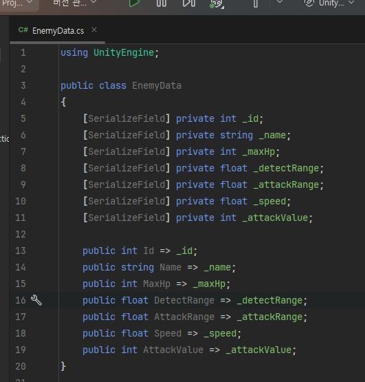

- 이렇게 해도 되고 프로퍼티로 해도 되지만 좌우지간 사용 가능하도록 설정은 해둬야 한다는 공통점이 있다.
- 생성자에서 모두 받아주도록 하자.

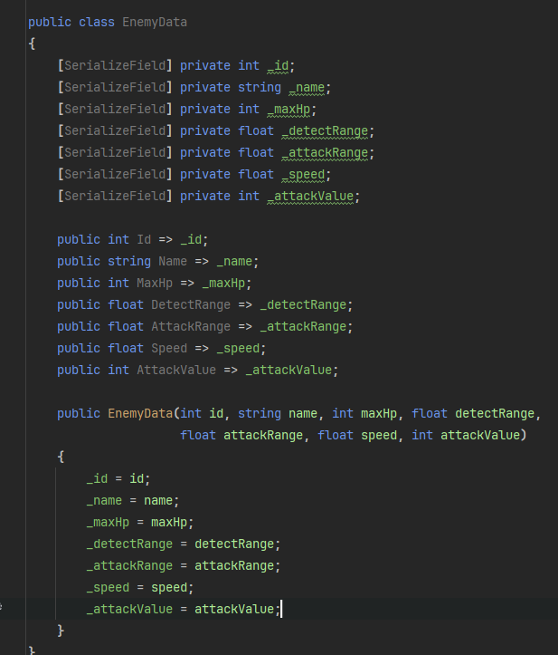

- 그 다음, 상단에 다음을 추가

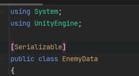

- 에디터에서 스크립트 추가, EnemyTableParser라고 명명한다.

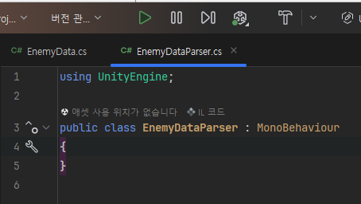

- 이것이 하는 일은 파싱 대상이 될 CSV 파일을 참조할 것이고 파싱해야 하며 외부 요청 시, 파싱 결과를 반환해주는 역할을 지닌다.
- 폴더 경로를 생성하고 다운받은 CSV를 넣는다.

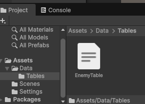

