# 3D AI Programming(5) SVC
## 1. 사전 준비
### 1.1. 구글 스프레드시트 생성
- 구글 스프레드시트를 하나 생성한다. 

- 몇번째 칸에 몇번 데이터를 읽도록 한다가 골자이다.
- 그런데 데이터를 중간에 끼워넣는다고 한다면 테이블 구조 전체를 바꿔야 할 수도 있다. 
- 일단, 4가지 정도로 설정해서 진행하자.

- CSV는 쉼표로 구분된 형태로 저장된다. 
- TSV는 콤마가 들어가는 string을 예시로 든다면 이상하게 나눠지므로 TSV 쪽을 추천은 한다. 
- 그래도 콤마로 하는 것이 직관적이므로 CSV로 진행할 것. 

### 1.2. 파일 생성
- 파일/다운로드/CSV로 다운을 받을 것.
- 일단 엑셀이 아닌 경우에는 다음과 같이 발생

- 그래서 Visual Studio Code에서 Rainbow CSV를 받아 설치한다. 

- 이제 데이터 뽑은 것을 심으면 되는 것인데 어떤 과정을 거치는 것인지를 생각하면 된다. 
- 사람이 보기엔 일정 데이터 부분을 찍어 가져가면 될 것. 

- 사실상 CPU 입장에서는 이 모든 것이 한 줄이고 문자열로 전개되어 있다. 
- 첫번째로 줄을 나눠줘야 한다. 
- 나누는 방법은 개행문자를 기준으로 줄을 나눌 것이고 결과물은 string[]로 나올 수 있을 것이다. 
- 두번째는 줄들을 순회돌면서 콤마를 기준으로 나눈다. 
- 이것도 역시 string[]이 나온다. 

- 이렇게 나눈 단위에서 string[]으로 콤마 단위로 다음과 같이 나뉜다. 

- 결국 2차원 배열과 흡사하게 접근만 하면 된다. 
- 줄로도 나누고 콤마별로 string을 나눴으니 접근하면 뽑아낼 수 있다. 
- split 2번 사용하면 바로 적용 가능하다. 

## 2. CSV 적용
### 2.1. EnemyData
- 프로젝트를 생성한다.
- EnemyData란 스크립트 생성한다.
- 현재 만든 CSV를 갖다가 실제로 담아뒀다가 쓸 수 있도록 처리가 필요하다. 
- Monobehaviour를 상속받지 않고 데이터 저장 용도로 쓸 것이다. 

- 이렇게 해도 되고 프로퍼티로 해도 되지만 좌우지간 사용 가능하도록 설정은 해둬야 한다는 공통점이 있다.
- 생성자에서 모두 받아주도록 하자.

- 그 다음, 상단에 다음을 추가

### 2.2. EnemyTableParser
- 에디터에서 스크립트 추가, EnemyTableParser라고 명명한다.

- 이것이 하는 일은 파싱 대상이 될 CSV 파일을 참조할 것이고 파싱해야 하며 외부 요청 시, 파싱 결과를 반환해주는 역할을 지닌다.
- 폴더 경로를 생성하고 다운받은 CSV를 넣는다.

- 다음과 같이 설정한다.

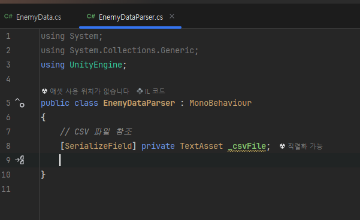
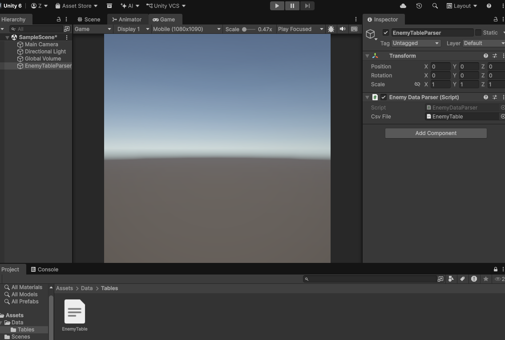

- 이것을 하게 된다면 다음과 같이 텍스트가 발생한다. 

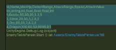

- 다 출력이 되어버린다. 
- 문자열이 여러 줄로 나뉜 상태가 아니다. 
- 이제 어디에 파싱한 것을 어디에 보관할지를 해줘야 한다.

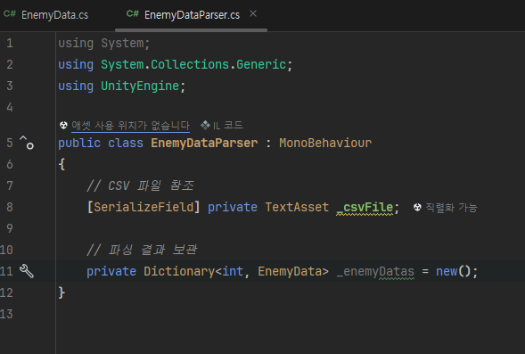

- 상황이 다르겠지만 두가지 조건이면 배열에 담아줄 수 있을 것.
- ID가 0으로 시작하지 않고 int형으로 담아두기 위해 Dictionary를 사용한 것. 
- 이제 파싱을 해보도록 하자.
- CSV기는 하지만 TSV더라도 크게 다를 것 없다. 
- CSV 파일은 한 줄 짜리인 것은 알고 있다.
- 이제 대문자 단위로 쪼개주면 될 것이니 다음과 같이 진행.

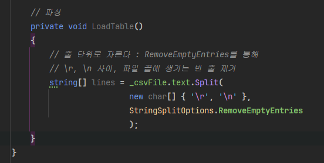

- 이스케이프 시퀀스인데 /n인 경우 줄바꿈이고 대문자 뿐만이 아니라 /r로 달려있을 수 있기 때문에 그것도 인식하도록 한다.
- 잘려져 있는 상태이고 이제 순회를 돌아야 한다.

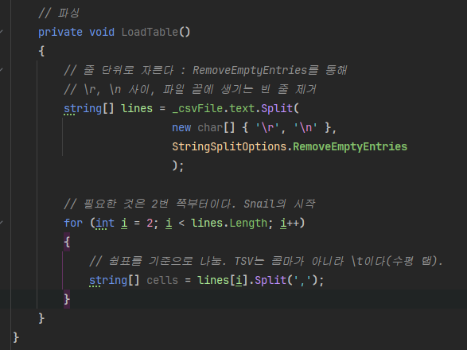

- 한 칸 한 칸이 문자열의 배열로 보관이 되고 있다. cells라는 배열에 보관된다.
- 그런데 만일 읽었을 때, 배열의 크기는 7칸이어야 한다. 
- 만일 7이 아니면을 설정해준다.

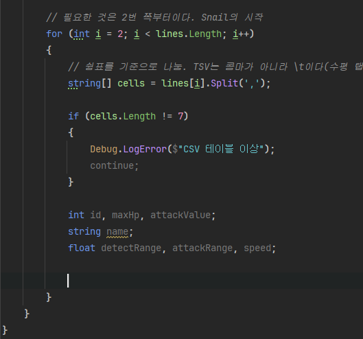

- 나눈 것을 배정해줘야 한다. 일단 좀 괴팍하게 가보도록 하자.

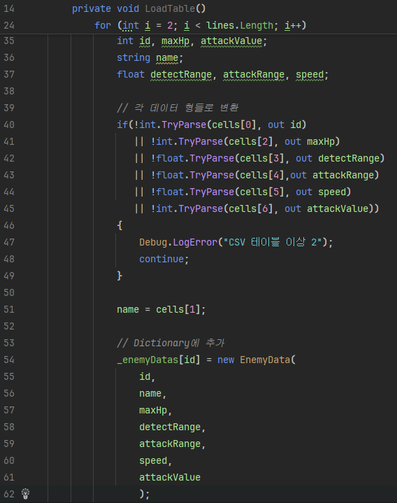

- 결과를 도출하는 것을 설정

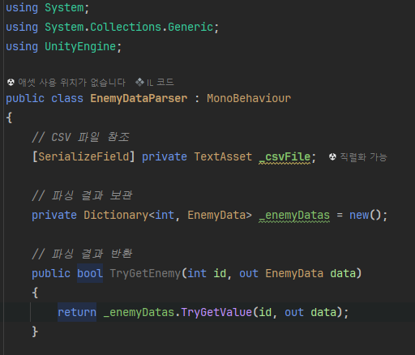

- Awake에서 LoadTable을 돌려주도록 한다.

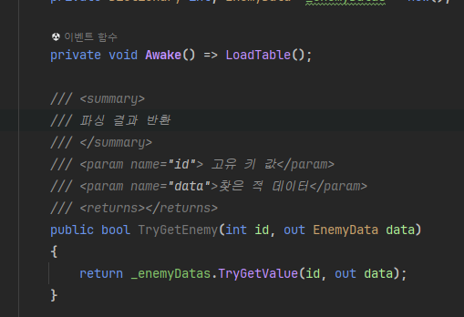

### 2.3. Enemy
- Load된 것을 사용해봐야 하니 스크립트 추가

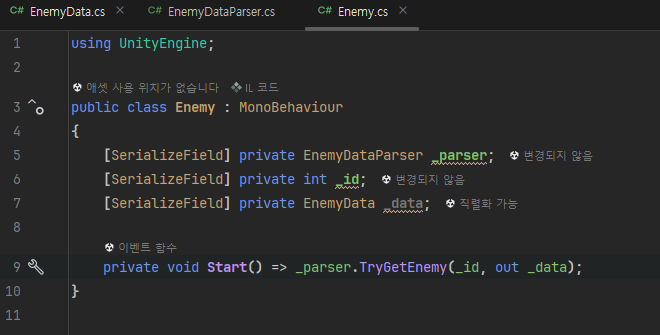

- 4개의 Enemy 추가하고 다음과 같이 설정한다.

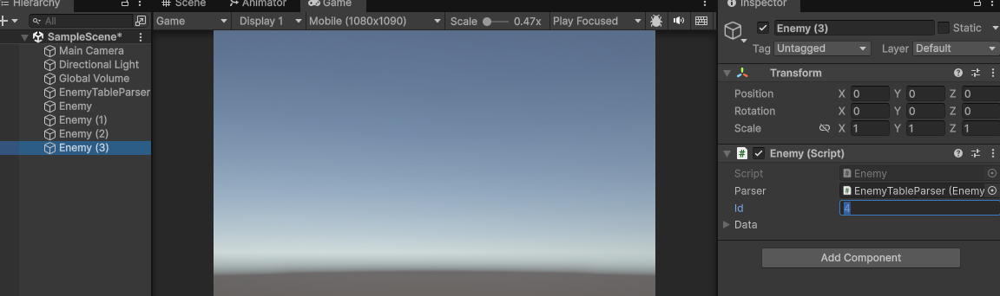

- 설정하면 자동으로 데이터가 입혀진다.

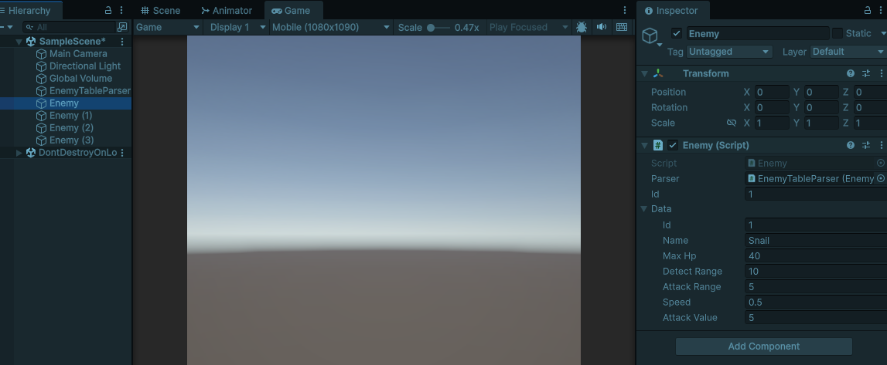

- 2차원 배열의 형태로 string으로 보관하다가 변환하여 담아줘도 되고 공통적으로 쓰는 형태는 지금인 편이다.
- 이 편이 가장 사용하는 단에서 편하다. 

## 3. JSON
### 3.1. 설명
- 대개 개념적으로 필요한 데이터를 나열한 것을 직렬화라고 한다.
- JSON이 그 직렬화 방식이다. 
- 앞에서 구현한 CSV를 JSON으로 다룰 수 있으며 JSON 유틸리티를 통해 파싱을 거치지 않고 바로 적용이 가능하도록 해준다.
- JSON 유틸리티는 읽기 같은 것은 당연히 되고 쓰기도 쉽다. 
- 클래스 내 있는 정보를 변환해주는 것이 잘 되어 있다.
- 이것을 통해 Save Load 구현이 가능할 것이다.
- ToJSON은 결국 JSON으로 바꾼다는 의미.
- FromJSON은 JSON으로부터 받아온다는 의미.
- 특징이라고 한다면 클래스 정의가 정확히 되어 있다면 데이터를 클래스 생성하면서 넣었다면 JSON으로 저장이 된다.
- 클래스가 변했다거나 오염되거나 깨진 것이 아니라면 소스 코드상, 고블린 데이터가 다음과 같이 저장된다.

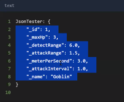

- 클래스 선언 단에서 내용이 변하지 않고서야 자동으로 불러와진다. 