# 3D AI Programming(6) Scritable Object
## 1. 개요
### 1.1. 복기
- Input System은 바인딩이 메인이었다.
- 상태 패턴은 디자인 패턴에 입각했지만 사용할만했고 비헤이비어 트리도 마찬가지였다.
- CSV는 인게임 데이터를 어떻게 불러오는지에 대해서도 명확했다.
- 그런데 스크립트 오브젝트는 직관적인 것은 아니고 쓰기 편해서이다.
- 인스펙터 단에서 스크립트 설정을 할 수 있다는 것이 장점이었다.
- 파일 하나 찍으면 수치 조정을 할 수 있게끔 하는 것이 Scriptable Object이다.
- 디폴트로 설정값이 있을탠데 개개인이 가지는 것이 아닌 뽑아서 쓸 수 있게끔 만들 수 있다. 

### 1.2. 플라이웨이트 패턴
- 변하지 않을 값이나 모든 객체들이 공유하는 값들을 한 군데만 생성하고 그것을 사용하는 방법이다.
- 엄밀히 말하면 이 패턴이 Scritable Object에 적용되느냐도 아니고 역도 아니지만 키워드로써 살펴볼 것.

## 2. 사용
### 2.1.
- 저번에는 CSV 파일을 파싱해서 줄마다 칸마다 잘라서 클래스 필드에다가 넣어줬었다.
- 그런데 정확히 CSV를 거쳐서 Parser를 거치고 Parser 내부에서는 파싱한 데이터(몬스터 데이터)가 있을 것이다.

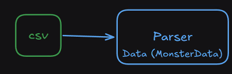

- 그 다음에는, 각 몬스터가 생성이 될 때 Parser에서 뿌려주는 형식이었다.

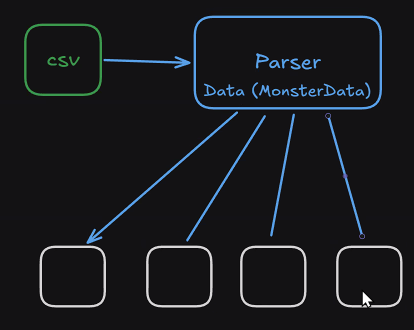

- 이번에는 한 단계를 더 포함시킬 예정이다. 
- 필연적으로 생성되는 과정에서 Parser를 참조를 하는데 그 연결고리를 끊어볼 것이다.
- CSV의 파일 내용이 변경될 필요가 있을 것이다. 
- 기존 EnemyTable을 갖고 MonsterStats라는 스크립트 하나 생성할 것.
- 상속받는 것을 ScriptableObject로 받을 것.

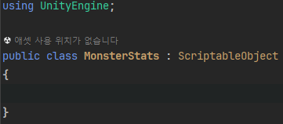

- MonsterData 필드를 복사해서 넣어준다.

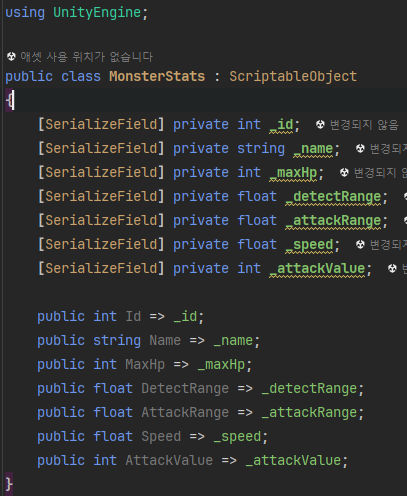

- 유니티 에디터에서의 변화는 없지만 MonsterStats는 이름 상에서는 모든 몬스터가 가져야 하는데 복사본 여러개가 생성된다는 것이고 이것을 기반으로 파일이 만들어져야 한다.
- 클래스 앞 쪽에 CreateAssetMenu라고 하고 다음과 같이 진행.

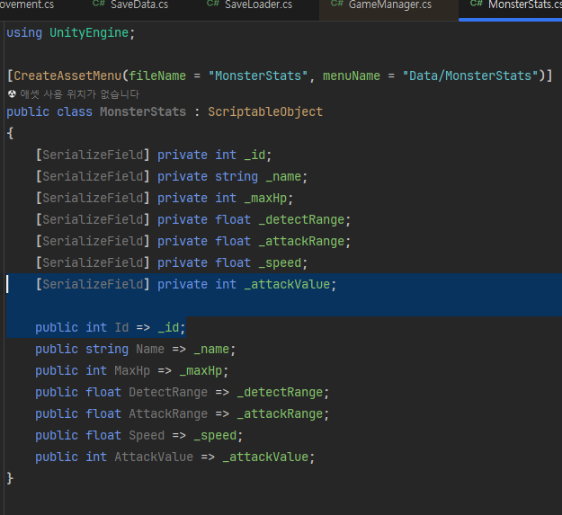

- 이렇게 하고 엔진에서 다음과 같이 진행

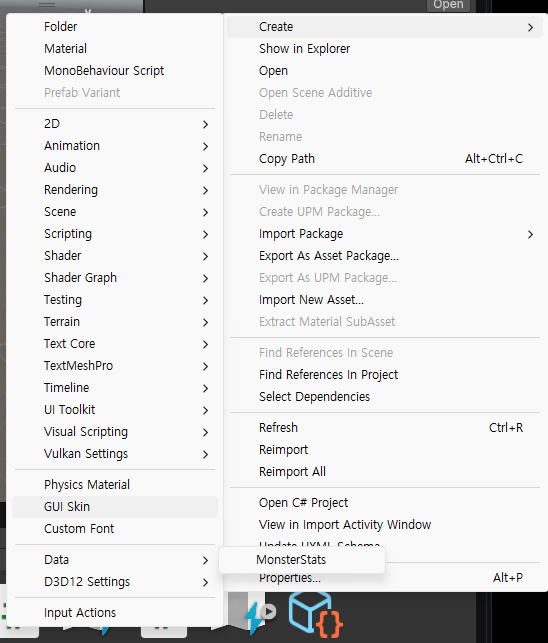

- 그 다음, Enemy에서 파서를 알고 있던 것을 지운다.

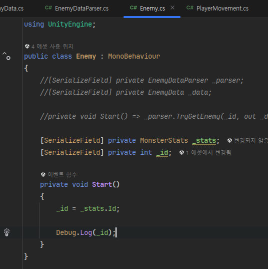

- 다음 엔진 단에서 다음과 같이 넣어준다.

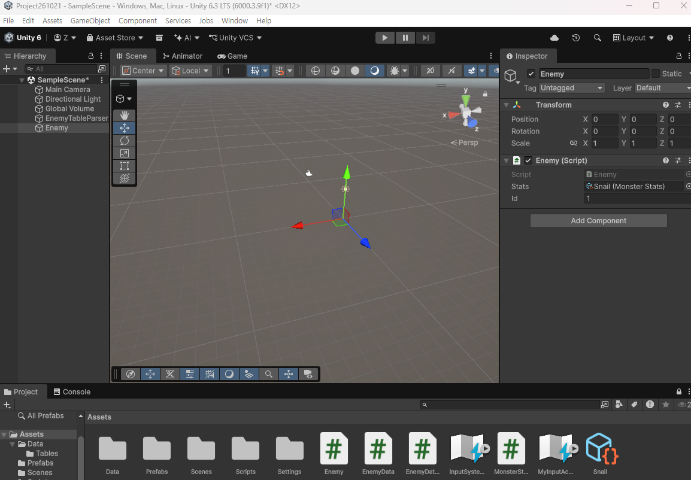

- 그래서 Enemy가 뽑아다가 쓴 케이스인데 Enemy들의 데이터들이 공통적으로 갖다가 쓰고 인스펙터 단에서 데이터를 공통적으로 다룰 수 있다는 것은 편한 것이다.
- 여기에서 SaveData 보관하는 용도로 생각한다면 오산이다.
- SaveData로 저장되는 것이 아닌 에셋처럼 사용한 것이다. 
- 실제 빌드에서는 모조리 초기화가 되어 있을 것.
- EnemyData라는 클래스가 유명 무실해졌다. 
- EnemyDataParser의 입장에서는 보관의 의미가 사라졌다.

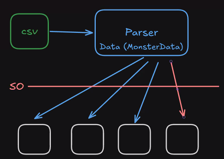

- 따라서 이런 느낌의 도식화가 되는 것.
- 일단 수정 진행을 하자.

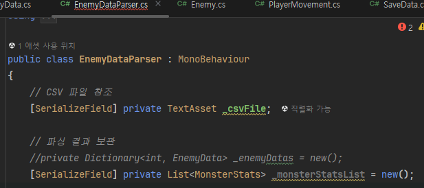

- List 선언 후, TryGetEnemy도 비활성화 시킨다. 
- 클래스 객체를 받아와 하고 있던 것을 다음과 같이 변경

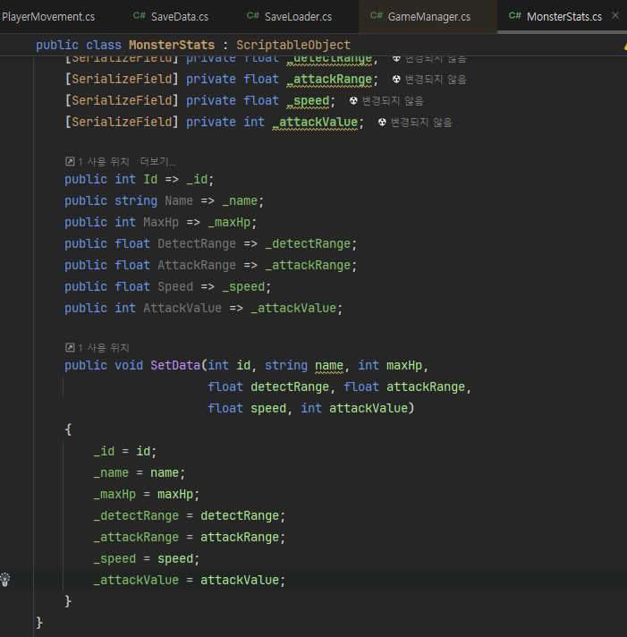
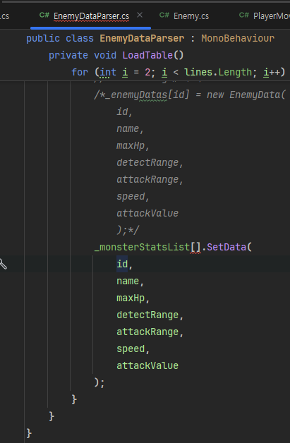

- 반복문으로 파싱을 했는데 2부터 시작하므로 i-2를 해주면 0번부터 진행될 것이다.

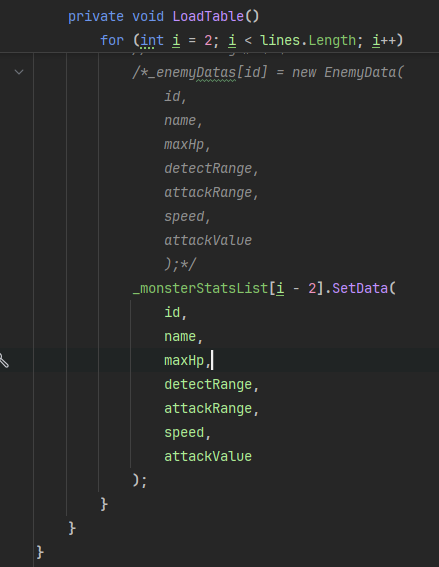

- 지금은 List로 직관적으로 하지만 특유의 키 값이 존재한다면 트리와 같이 다른 것을 쓸 수 있다. 

- 데이터 테이블을 체크하고 그래야 하는 것은 맞다.

### 2.2. 상황정리
- 실제로 돌아가는 게임이라고 생각했을 때는 몬스터가 소환되어 있지는 않는데 intro를 통해 초기화하고 Title을 보여주는 등을 진행한다.
- Initialize 단계에서 스크립터블 오브젝트 정보를 미리 담아주는 것. 
- Enemy 입장에서는 데이터대로 잘 소환된다. 

### 2.3. 사용처
- 퀘스트
- 튜토리얼
- 실예

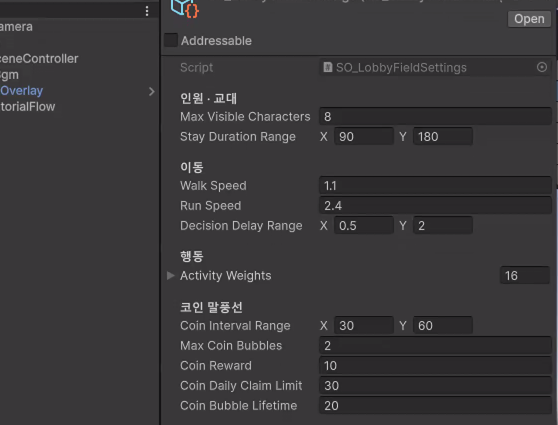
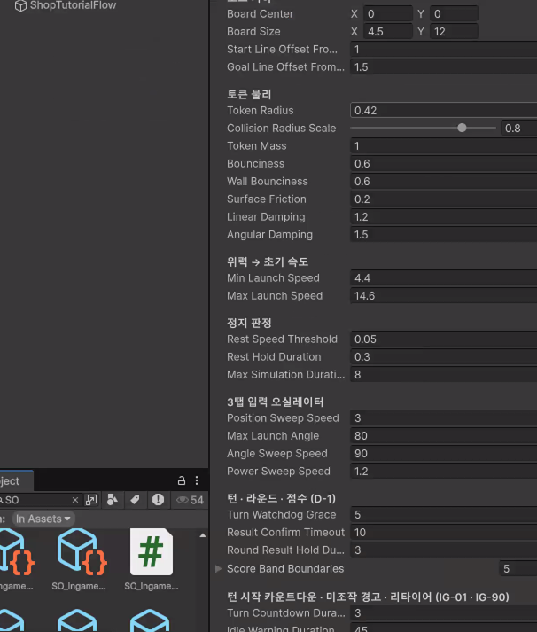