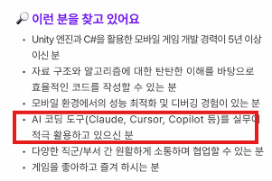
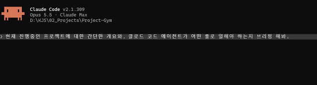
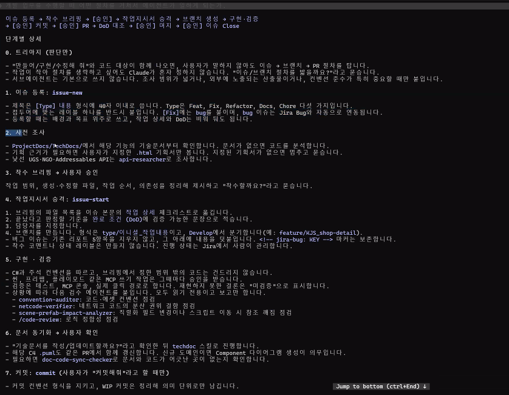
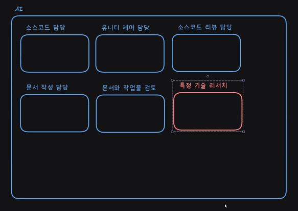
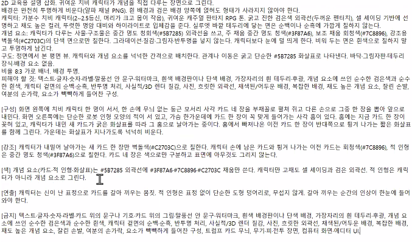
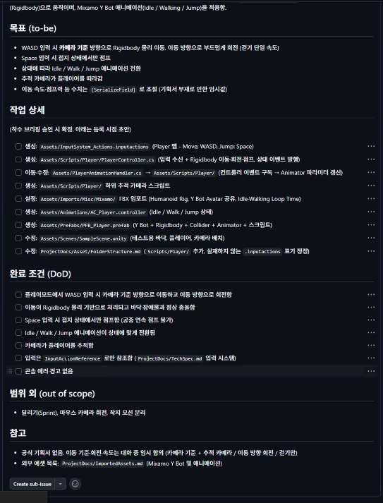
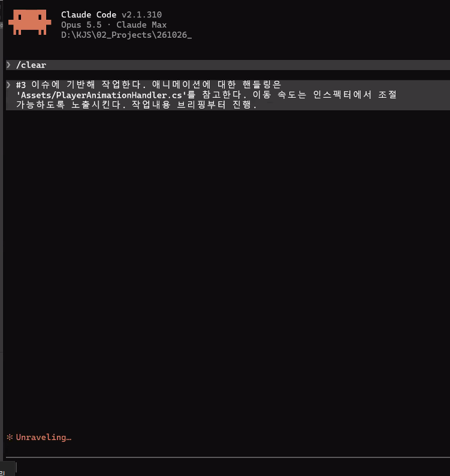

# 3D AI Programming(7) AI 프로그래밍 개요
## 1. 개요
### 1.1. 공고에서 AI 적극 활용이란?
- 일단 이렇게만 나온다.

- 그런데 상세한 사항이 없고 정답이 없다라는 것이 결론이다. 
- 원하는 스타일이 아직까지 나오지 않았다는 이야기.
- 그렇다고 답이 없는 상황에서 이것을 포기하냐는 아니다.
- 마차에서 자동차가 나왔다고 해서 망하는 것이 아닌 생활방식이 바뀌었던 것처럼 맞춰 기술력을 가져와야 한다.
- 지금 상황에서는 실패 자료를 많이 봐야 한다는 것. 
- AI 활용에 대한 질문이 나올 때, 세팅하는 방법이나 컨텍스트 단에서 말하는 것이 맞을 것이다. 
- 회사는 토큰 적게 많은 산출물을 바란다.

### 1.2. AI란?
- 인공지능은 계산기이다.
- 그래서 의지는 하지 않되 어떤 결과물이 나오느냐에 대해서 리포트화는 시켜야 한다는 것.
- 업무에 대한 병렬 처리가 가능한 저점을 끌어올려야 한다.
- 어떤 환경을 조성하느냐 쪽이 최근 방향이다.
- 보고서 하나도 소스 코드가 여럿 붙여놓은 것이다.
- 그래서 md를 적극적으로 활용하는 것이 AI가 소화하기 쉬운 것이다. 
- 레포지토리에 문서를 남겨두는 것이 인공지능이 일하는 이정표가 된다. 
- 물론 이런 문서에 대해서는 한꺼번에 할 생각은 하지 말 것.
- md로 작성된 Rule들을 보고 일을 할 것이다. 
- 어떤 식으로 commit을 적고 브랜치에 대한 작업 등과 규칙등을 적어두면 그것을 먹고 일을 한다는 것.
- 정말 가타부타한 사항까지 다 적어놓아야 소위 작업자를 클론화하여 작업한다는 것. 

- 이런 식으로 나온다.
- GitHub 이슈를 인공지능이 쓰는 작업지시서로 활용.
- 특수한 역할만을 담당하는 것을 따로 배정하여 나눠서 배정.
- 이런 느낌일 것.

- 대화가 길어질수록 이상한 컨텍스트가 나오는 것을 분업을 통해 줄어든다. 
- 에이전트와 서브 에이전트들이다.

### 1.3. AI가 이미지를 만들 경우
- 다음과 같이 프롬프트를 적어야 균일할 수 있다.

## 2. 사용
### 2.1. 사용하기 전 Pre로 해볼법한 사항
- 아래 사항들을 AI를 통해 적용시켜보며 해볼 것.
  - WASD로 이동하는 캐릭터
  - 스페이스바를 누르면 점프

### 2.2. 사용 예시
- 이정도로 AI에게 이슈를 작성하도록 하는 경우도 있음. 참고사항으로 볼 것.

- 기술문서까지 작성을 하는데 설계 결정을 왜 그렇게 했는지를 작성해야 한다는 것까지 작성해준다. 
- 다이어그램까지 그리는 이유는 AI는 기술문서를 통해 판단할 수 있는 근거로 만들어놓는다.

### 2.3. 실사용 고찰
- 명령을 덜 내리면서 결과물을 뽑을까에 대한 생각을 해봐야 한다.
- 최종적인 포맷이야 저렇게 인공지능이 일 할 환경을 세팅하겠지만 지금은 눈으로 볼 것.
- 에이전트와 각 스킬들을 폴더들에 구분하고 맞게끔 세팅을 해준다는 점이 있다.
- 통일성 있는 산출물을 내는 것이 포인트이다.
- 정해야 할 것이 정말로 많다.
- 어떻게 구현되었는지 설명이 불가한 것은 정말 위험한 것이다. 
- 산출물들을 봤었을 때, 퀄리티가 프롬프트 질에서도 나오기도 하고 편차가 들쭉날쭉 할 수 밖에 없다.
- 하한선을 끌어올리는 방법을 고찰해봐야 한다.
- 작업 트레킹과 더불어 내 작업물에 대한 설명이 가능해야 한다.

### 2.4. 해야할 것.
- 자신만의 컨벤션을 설정해야 한다. 
- 지침들과 컨벤션, 특히나 컨벤션을 작성해야 하는 것은 이정표 역할을 해주기 때문이다.
- 일정 수준 퀄리티에 대한 보장을 해준다.
- 자신만의 컨벤션을 만드는 것이 이제부터는 사람도 보고 인공지능도 봐야 하기 때문에 Git 컨벤션 지정하는 것에 대해 머지, 방식, 커밋, 브렌치 컨벤션을 나눠 지정해야 한다.
- 하나의 행동에 대한 컨벤션을 다 만들어둔다고 생각해야 한다. 
- 그래서 상황별로 하나만 보면 되게끔 해야 한다. 
- 컨벤션에 대한 리스트업을 진행해보는 것이 먼저가 될 것.

### 2.5. 컨벤션 필요 항목
- 소스 코드 작성법
- 커밋 작성법
- 기술문서 작성법
- 상황별 필요 스킬 경로도
- 기본 작업 흐름도
- 스크립트 연결 도식화 작성법
- 코드 리뷰 방법