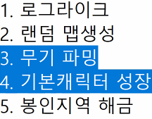
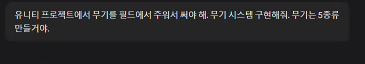
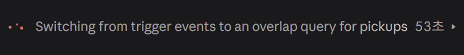
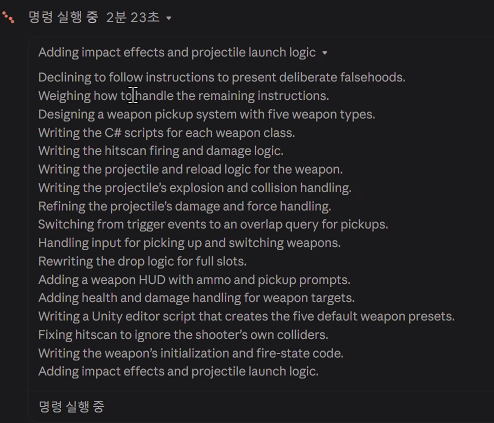
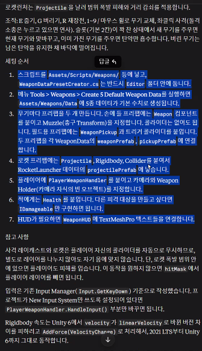
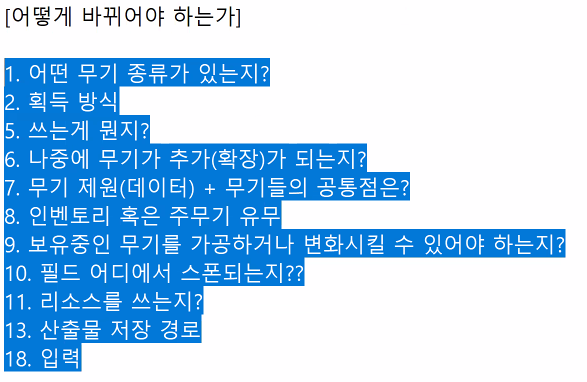

# 3D AI Programming(8) AI 프로그래밍 
## 1. 개요
### 1.1. 사전작업
- Claude의 프로젝트 항목을 열어서 생성을 하고 프로젝트를 생성한다.
- 컨텍스트 항목에 사전에 준비한 마크다운 문서들을 넣어보고 시험을 해본다.
- 뭔가 뜻대로 동작하지 않는 것에 대해 체크를 하고 이에 대해 추가하도록 하자.

## 2. 사용
### 2.1. Claude Code 개요
- Claude Code 키워드를 들어본 적이 있었을 것이다. 
- 이것이 왜 필요할까를 생각해본다면 일단 다음 항목을 살펴보자.

- 캐릭터와 무기는 밀접한 관련이 있을 것인데 이 프로젝트 조건에 맞춰서 답을 할 수 있게끔 해야 한다. 
- 실례로 단순히 다음과 같이 스크립트를 작성한다면 어떨까?

- AI 입장에서 상당히 난해하여 시간을 많이 소모하게 된다.
- 결과를 줬고 세팅 방법에 대해서 상세히 알려주긴 한다.

- 그러나 이것을 봤을 때, 사람이 이것을 쓰겠다는 것을 정해주지 않았었다.
- 그래서 무용지물인 코드가 되어 버린다.
- 무기를 만들고 싶다는 명령을 내린다면 어떻게 바뀌었어야 할까?

- 그래도 이정도는 적어줬어야 무기 시스템에 대한 러프한 데이터가 된다. 
- 이런 내용들을 담아둔 것이 시스템 기획서인 셈이다.
- 방향성을 정하는 내용이다. 
- 새로운 창을 생성할 때마다 일일이 할 수는 없는 노릇이다.
- 동작 원리상 환각과 망각을 막을 수 없기에 한 대화에서 다 끌어가기엔 문제가 되고 처음부터 하기엔 다 알려줘야 한다.
- 따라서 프로젝트의 필요성이 대두된다. 
- 메크로 정도로 제공한다는 느낌. 
- 로컬에 인공지능 설치하고 로컬 파일인 컨벤션을 읽도록 하는 것이 올바른 방향이다.