# 3D AI Programming(9) AI 프로그래밍 
## 1. Claude Code
### 1.1. 사전작업
- 유니티 프로젝트를 생성하고 해당 프로젝트를 Github Repository에 할당하여 준비한다.
- 이 후 이것을 중심으로 쓰일 예정
- TextMeshPro, 이벤트 시스템 등을 추가한다.
- Docs 폴더를 추가하고 작성한 컨벤션들을 넣어둔 다음 분류해둔다
- 해당 경로에서 터미널로 연결한 다음 Claude Code를 시행한다.
- 이전 프로젝트의 컨벤션은 컨텍스트에 들어갔고 지침은 딱히 적어놓지 않았는데 Claude가 지켜야 할 수칙들이 적혀있어야 한다.

### 1.2. 지침
- Claude에서 지침에 명령을 내리면 지침을 가장 먼저 읽게 된다. 최소한 하면 안되는 것과 기본적인 프로젝트 개요를 적으면 된다.
- Claude Code 상에서는 어떻게 해야 하냐면 이 경로에 파일을 만들고 CLAUDE.md라고 하나 만든다.
- 이 곳에 지침 등을 적으면 된다.
- \Docs\Claude 폴더를 만들고 일단 ClaudeCodeRules.md라고 명명한다.

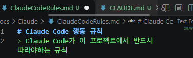

- 절대 원칙을 부여해놓는다.

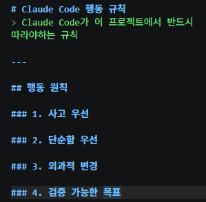
- 첫번째는 생각 후 코딩을 하라는 이야기이다.
- 가정을 숨기지 말고 하라는 의미이다.

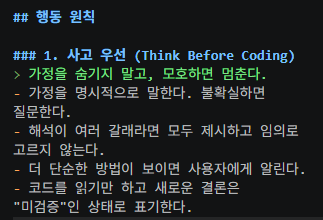

- 다음은 단순함 우선인데 문제를 푸는 최소한의 코드를 작성, 즉, 겉멋 부리지 말라는 의미.
- 필요할 때만 리펙토링을 하면 되는 부분이다.

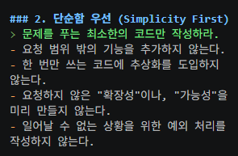

- 외과적 변경에서는 판단 기준을 부여한다. 
- 이게 중요한 것이 내가 작성한 코드가 사라져있다. 
- 더 문제는 팀 프로젝트가 돌아갈 때, 임의로 변경하는 행위를 할 수 있다. 
- 1, 2번의 경우는 당연한 이야기이고 잘 따르지만 3번은 잘 안 따를 수 있다. 그래서 이런 부분에 대해서 목표를 제시하고 일을 하게끔하는데 브리핑을 하도록 시킨다. 
- 기존 코드에서 변경이 일어나는 부분은 확인해야 할 사항이다. 

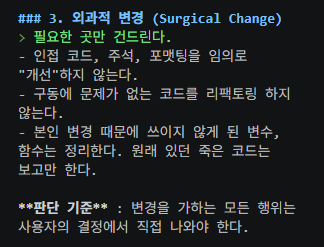

- 다음은 인간이 납득 가능해야 한다.

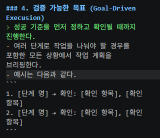

- 기존 돌아가는 기능에서 리팩토링으로 인해 안되는 경우가 있다. 
- 그래서 레거시 코드들에 대해서는 손을 대면 안된다. 
- 다음으로는 작업 범위 규칙을 넣어줘야 한다.
- 어느 선까지 작업시킬까에 대해서를 지정하는 것이다.

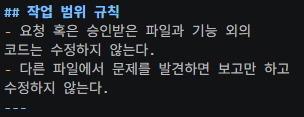

- 업무 프로세스를 발견했으면 내 산출물일수도 있겠지만 팀원의 산출물일 수 있다. 
- 버그라도 로우 단계일 수 있다. 
- 그런 것까지 수정하다가 망가뜨리는 것보단 이슈만 올려두도록 하고 때 되면 고치게끔 해야 한다.
- 다음은 기능 구현 착수 규칙을 정해준다.

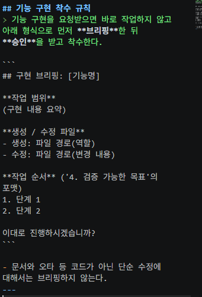

- 응답 규칙은 다음과 같다.

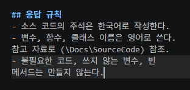

- 그 다음, CLAUDE.md에다가 상대 경로를 걸어서 클로드가 타고 가서 읽게끔 설정한다.

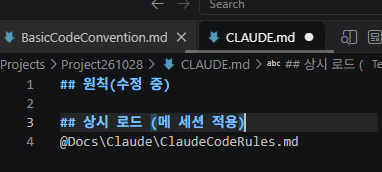

- 이제 명령을 내려보자. 
- 중요 지침들을 적용하고자 한다면 /quit을 해준 다음 재시작
- 다음과 같이 작성

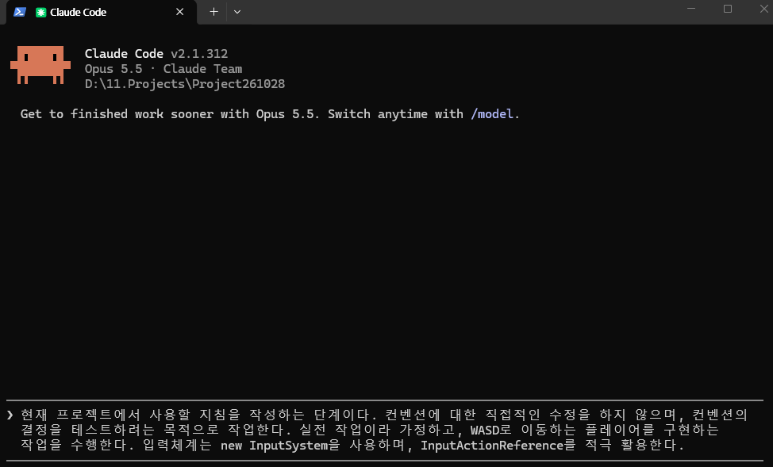

### 1.3. 컨벤션 이식
- 만일 레퍼런스를 언급을 하지 않았다고 한다면 다른 결과가 일어났을수도 있다. 
- 원하는 정보가 나오려면 프롬프트를 쓰면서 어떤 것을 사용할 것인지에 대한 언급이 필요하다. 
- 프로젝트 스펙에 대한 기술문서를 마련해놓으면 프롬프트에서 더 언급할 것은 없을 수 있다.
- TechSpec.md를 새로 만든다.
- 기술들에 대한 것을 모아놓은 문서를 만들어준다.
- AI가 일을 알고 있다면 상관없을 것이다. 
- 필수 기술들에 대해 명시를 해놓는 방향으로 접근해야 한다.

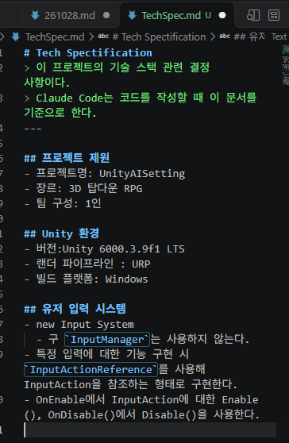

- Scene 관리도 여기에 해줄 수 있다. 
- 해당하는 경로를 CLAUDE.md에 옮겨주고 다시 동일한 방식을 취해준다.
- 뭐 의도대로는 나왔다.
- 그러면 이제 만들어둔 컨벤션을 넣고 CALUDE.md에 상시 로드에 경로를 설정한다.
- 다시 지우고 재시도를 수행한다.
- CLAUDE.md는 지침이고 기본 전제들을 정의를 해줘야 한다. 
- 만일 의도치 않은 산출물이 나오거나 기대하고는 다른 결과물이 나온다면 CLAUDE.md가 모든 지침과 md들의 허브여야 한다.
- 상시 볼 필요 없는 것에 대해선 구분을 지어 분류를 해줘야 할 것이다.

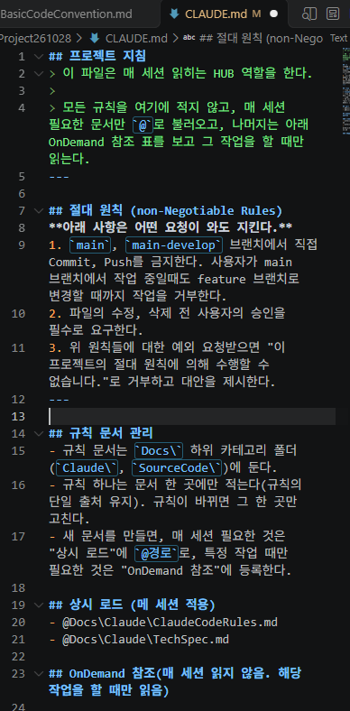

- 버전별로 조건별로 걸어주는 것이 필수였으나 아닌 케이스들로 완화가 되는 것이 있었다. 
- 그래서 커스텀을 사용자가 해야 하며 그 책임을 온전히 지는 것은 사용자이다. 