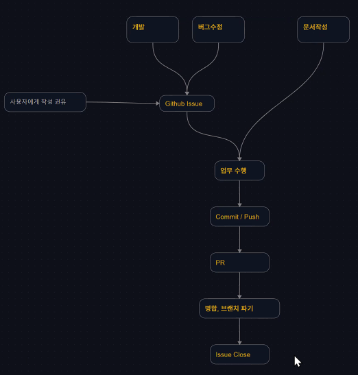
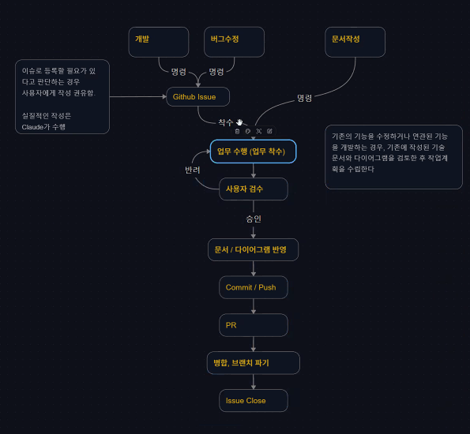
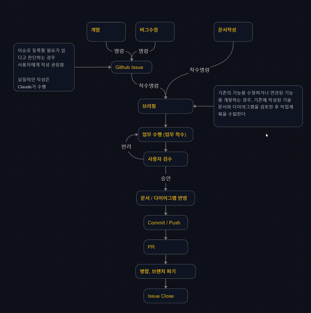
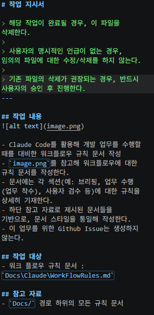
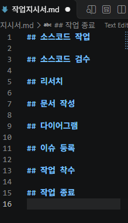
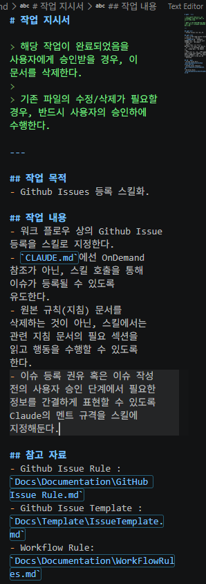

# 3D AI Programming(10) AI 프로그래밍 
## 1. Template
### 1.1. 경로 개설
- Docs 하위에 Template을 두고 작성한 PR, Issue들을 둔다.
- Docs 하위로 Temp라는 임시 폴더를 개설한다.

## 2. Issue
### 2.1. Template
- 설명보단 어떤 양식으로 해야 하는 것에 대해 적는 것이다. 설명은 컨벤션에 가깝다. 
- Issue는 인공지능의 작업 지시서로 활용될 수 있다.
- 예시는 다음과 같다.

## 2.2. Issue Rules
- 타이틀은 기능 단위로 적도록 하고 길어지면 안된다.

- 배경 및 목적은 클로드 단에서는 적을 수가 없다. 
- 그래서 사람이 알려줘야 하는 것이 맞다. 
- 목적에 모른다면 팀장 등에 물어본다.

- 목표는 이렇게 진행된다.

- 작업 내용은 다음과 같이 진행한다.

- 완료조건은 다음과 같다.

- 특이 사항에는 보통 이것을 수행하기 위한 최소 조건이나 전제 조건들이 기재가 되어야 한다.
- 다음과 같이 진행된다.

- 기타 사항은 보통 라벨 분류를 적어둔다.

## 2.3. CLAUDE.md에 등록
- OnDemand 참조 쪽으로 들어가야 한다.
- 상대 경로를 넣어주면 이슈를 잘 작성한다.
- 그런데 현재는 다른 기능을 넣으려고 한다면 이슈를 작성하지 않고 그대로 또 진행하려고 한다. 
- 이슈 작성 자체를 강제를 해야 한다. 
- 아주 가벼운 단위의 작업, 가령 공통적인 인터페이스 껍데기를 작성하는 정도는 이슈가 필요치 않다. 
- 게임에서 영향을 끼치는 것은 이슈작성을 강제시킬 필요가 있다.
- 강제시키려면 어딘가에 명시를 해줘야 한다.

## 3. WorkFlow
### 3.1. 개요
- 업무 흐름이라고 할 것이 몇가지가 있을 것이다.
- 개발, 버그 수정, 문서작성 이 3가지로 수렴이 된다.
- 개발, 버그수정의 경우는 작업에 들어갈 때 현재의 전제조건에서는 Github Issues를 거쳐가야 하는 것이 베스트이다.
- Github Issues를 거쳐서 업무 수행에 들어갈 것이다. 
- 이슈에 대한 것은 사용자에게 선택권을 줄 경우가 좋다
- 규모가 있을 경우 권유를 해줘야 할 것.
- 업무 수행 후, Commit / Push가 되어야 할 것이다. 
- Pull Request가 이후 진행될 것이며 병합 처리(PR 승인 및 브랜치 파기)가 진행되고 이슈를 닫아줘야 한다.
- 이런 흐름을 가지고 진행이 되어야 한다.

### 3.2. Rules
- 작은 단위로 시작하되 개선을 권유하는 방향으로 확장시키도록 한다.
- 이것 역시 Claude를 통해 작성하라고 할 수 있다. 

- 몇 회의 승인 과정 후 작성을 시행한다.
- 검토 후 수정할 곳을 살핀다.
- 그리고 작업 해보도록 하자.

## 4. 스킬
- 함수와 같은 기능이다.
- 워크 플로우에 올라가는 방식을 적용한다.

- 이번엔 이슈를 생성하는 스킬로 접근해볼 것이다.
- 약속된 행동도 부여하는 것이 가능하다.

- 이것을 읽고 처리라고 하라고 한다. 
- PR 단을 개인별로 해볼 것. 완료조건이 PR에 그대로 들어가도록 설정하는 것이 좋을 듯