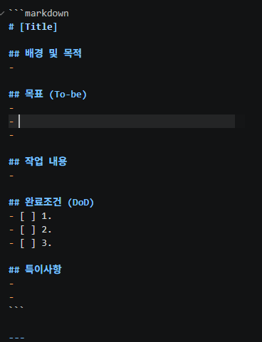
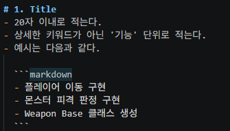
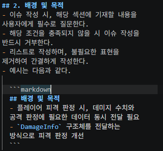
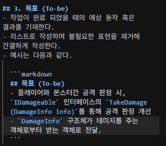
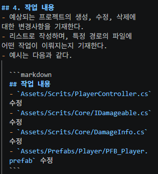
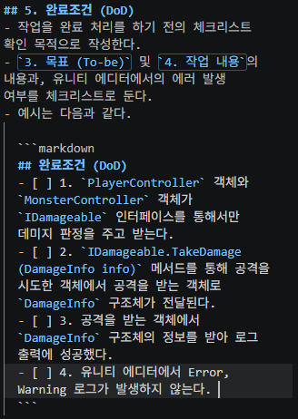
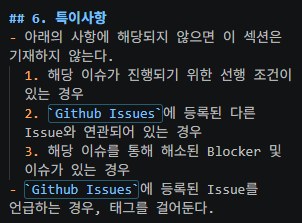
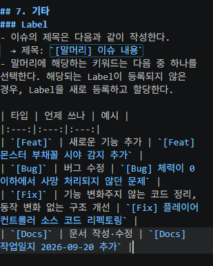

# 3D AI Programming(10) AI 프로그래밍 
## 1. Template
### 1.1. 경로 개설
- Docs 하위에 Template을 두고 작성한 PR, Issue들을 둔다.
- Docs 하위로 Temp라는 임시 폴더를 개설한다.

### 1.2. Template
- 설명보단 어떤 양식으로 해야 하는 것에 대해 적는 것이다. 설명은 컨벤션에 가깝다. 
- Issue는 인공지능의 작업 지시서로 활용될 수 있다.
- 예시는 다음과 같다.

## 1.3. Issue Rules
- 타이틀은 기능 단위로 적도록 하고 길어지면 안된다.

- 배경 및 목적은 클로드 단에서는 적을 수가 없다. 
- 그래서 사람이 알려줘야 하는 것이 맞다. 
- 목적에 모른다면 팀장 등에 물어본다.

- 목표는 이렇게 진행된다.

- 작업 내용은 다음과 같이 진행한다.

- 완료조건은 다음과 같다.

- 특이 사항에는 보통 이것을 수행하기 위한 최소 조건이나 전제 조건들이 기재가 되어야 한다.
- 다음과 같이 진행된다.

- 기타 사항은 보통 라벨 분류를 적어둔다.

