# 3D AI Programming(11) AI 프로그래밍 
## 1. MCP
### 1.1. 개요
- 에디터를 효율적으로 다룰 수 있게 만드는 것이다.

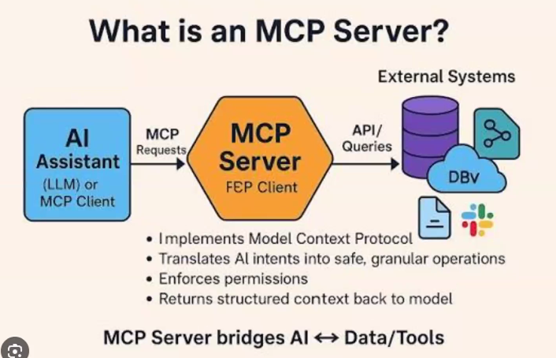

- AI 에이전트는 유니티 환경에 대해 모르기 때문에 보이는대로 스크립트 써서 구성을 해준 것이다. 
- AI 에이전트가 알 수 있도록 해야 할탠데 MCP 서버라는 다리를 하나 놓아준다. 
- 인공지능이 접근했을 때, 이 기능을 써야 한다고 정의된 상태이다. 

### 1.2. 사용치
- 이전까지는 직렬화 데이터(.meta)를 통해 작업을 했었었는데 좀 더 명확하게 적용된 것을 적용할 수 있다.

### 1.3. 세팅
- 브라우저에 node.js라고 검색
- Get Node.js를 클릭하고 다운받을 것.

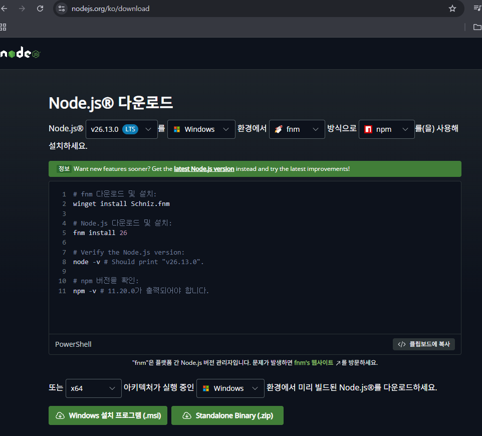

- 그 다음, npm --version 확인.
- 없다면 java를 검색해서 다운받을 것.

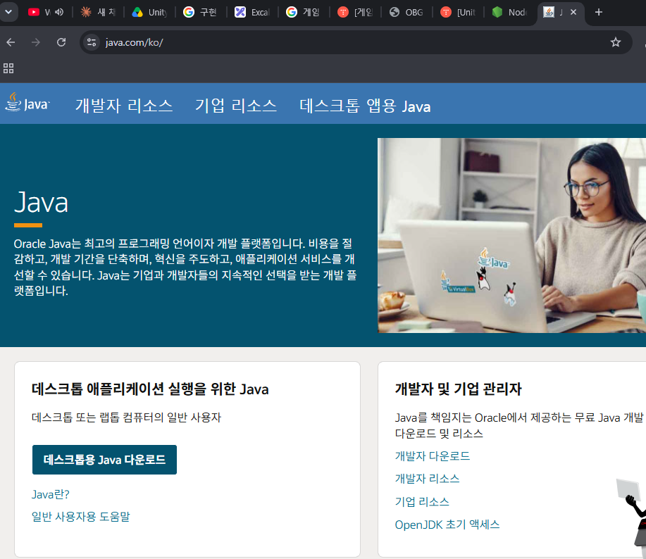

- cmd를 켜서 진행하고 접근시키기

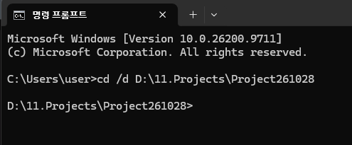

- 해당 경로에 npm install -g unity-mcp-cli라고 타이핑하여 설치 진행
- 다음, cmd를 닫고 터미널로 계속 진행. `unity-mcp-cli install-plugin .`라고 타이핑.
- 안되므로 에디터 패키지 단에서 진행.  https://github.com/IvanMurzak/Unity-MCP/releases 에서 플러그인 다운받을 것.
- 다운을 다 완료하면 다음과 같은 것이 발생한다.

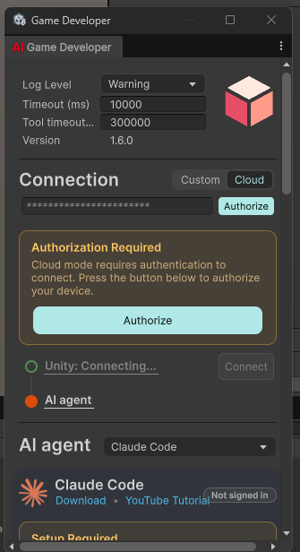

- 설정 필요.

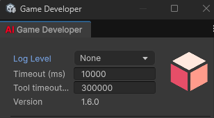

- Custom으로 가서 확인을 해보면 다음과 같이 나온다.

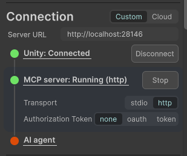

- AI 단에서는 임시 서버를 통해 유니티를 접속한다. 
- 그 서버는 mcp서버가 열어놓은 로컬 호스트이고 AI는 이 쪽으로 들어가서 유니티를 조작할 수 있게 된다. 
- AI Agent가 연결된 상태는 아니다. 
- /mcp를 치면 확인이 가능하다.

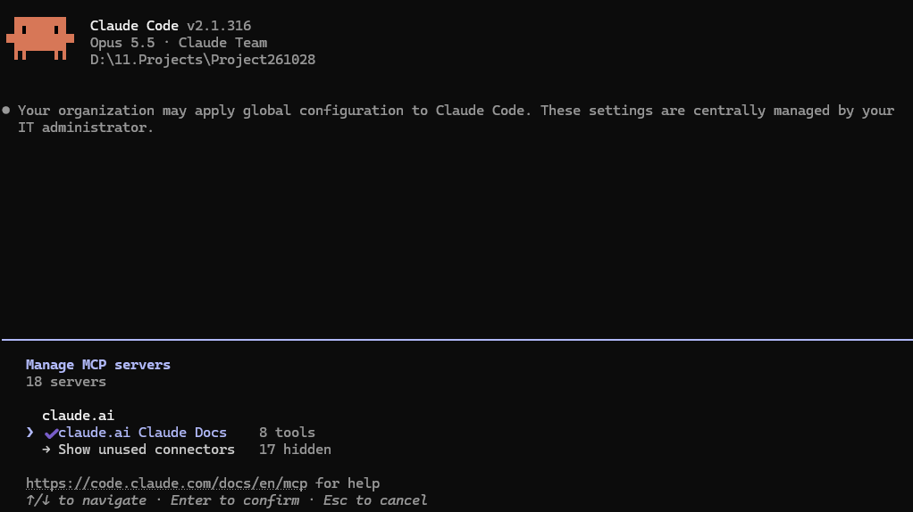

- 코드를 확인하고 MCP에서 Configure를 눌러준다.

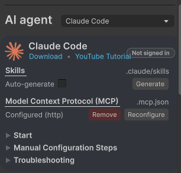

- 접근하면 다음과 같이 접근을 하겠다고 .mcp.json 상에서 나타남.

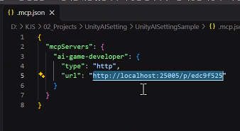

- 추가적으로 해야할 것이 있는데 terminal에서 Claude Code에서 `unity-mcp-cli setup-mcp claude-code .` 라고 해본다.
- 안나온다면 cmd에서 다시 한 번 진행해볼 것.

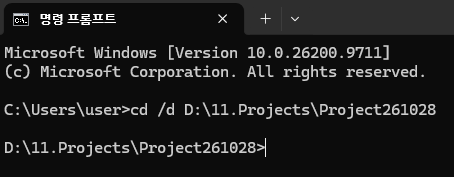

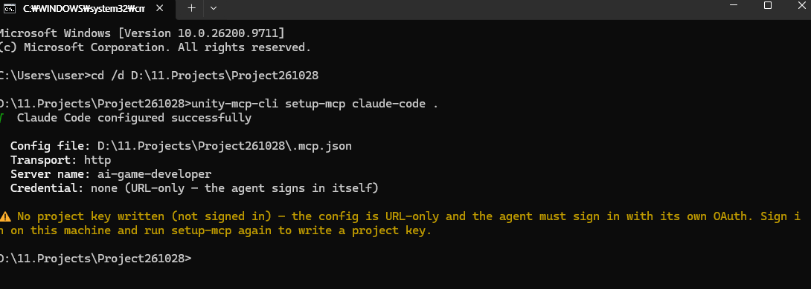

- ` · run /mcp`로 실행. 혹은 `/mcp` 후 해당 경로로 들어갈 것. 

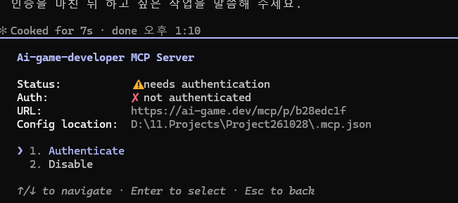

- 계정 인증이 되어야 한다.
- 1번을 진행하여 계정 인증을 거치면 다음과 같이 발생한다.

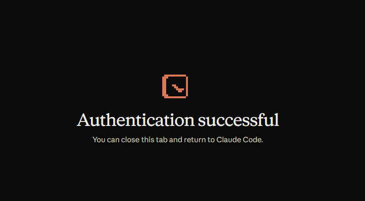

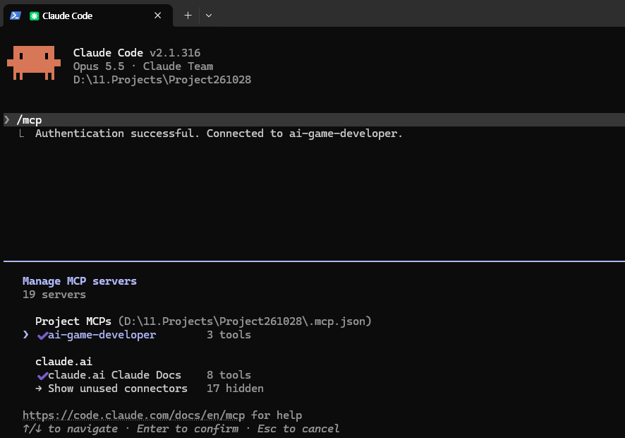

- reconfigure로 하고 터미널과 유니티 다시 재실행

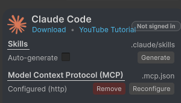

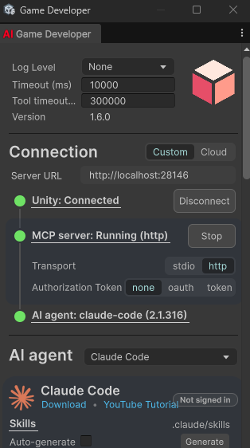

- 여기까지 세팅이 끝났다면 한 번 UI 수행을 시켜볼 것이다. 
- 아까는 스크립트로 진행이 되었었는데 이번에의 차이는 다를 것이다.

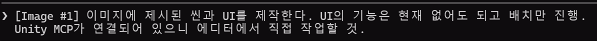

- 진행했을 때, 다음과 같은 결과로 이어진다. 

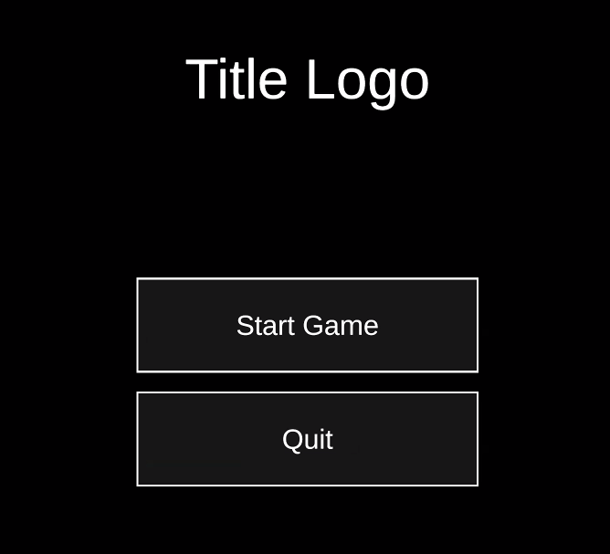

- 유니티 특정 작업에 대한 접근을 가이드 받은 상태이며 배치를 그렇게 한 것이다.

### 1.4. 정리 
- 여기에서 유니티 제어가 된다면 가능한 사항이 있긴 하지만 이것을 사용하진 말 것. 

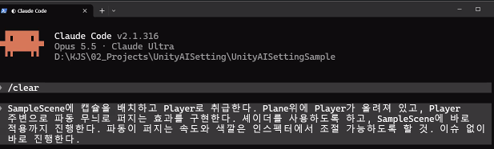

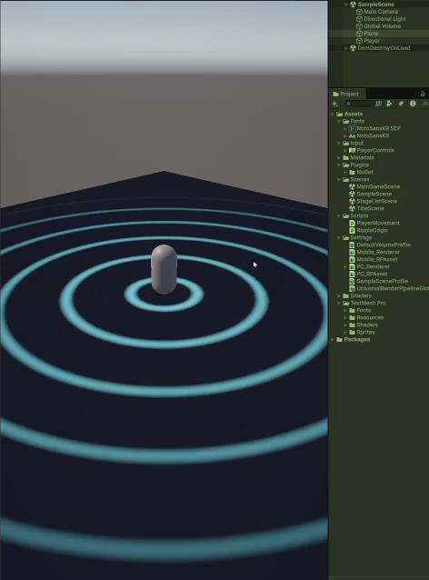

- 거의 자기가 알아서 플레이해서 테스트까지 진행한다. 
- 소스 코드 단위로 노는 것이 아닌 산출물 단위가 되어버린다.
- 하지만 AI가 한 것을 자신이 알고 작업한 것이 아니다. 
- 스타일을 갖춘 다음에 사용하는 것을 모토로 한다.
- 자신과 동반해서 쓰는 것이지 어마어마한 것을 요구하는 단계는 아니고 개발자 퍼포먼스를 보여주는 것은 아니다. 
- 단기간의 피트되는 설정은 잡긴 어렵다. 
- 수료할 때 쯤 되어서 프로젝트 돌려보는 경험으로 가져가겠다라면 폼으로 써보고 학습시켜서 튜닝을 해나가야 한다. 

### 1.5. 추가되어야 할 것.
- UI 계층 구조
- 어떤 설정은 절대로 AI가 건드리면 안되는 부분
- Switch 플랫폼이 아닌 빌드 프로파일을 설정하는 것이 있는데 그것을 세팅하고 여러 빌드를 떠야 하면 스킬로 만들어 순차적으로 돌리게끔 하는 것도 가능.