# 3D AI Programming(12) AI 프로그래밍 
## 1. 개인 포트폴리오
### 1.1. 방향성 설정
- AI를 쓸 것인가 안 쓸 것인가?

- 소재는 뭘로 할 것인가?
  - 일단 포트폴리오를 써놓고 R&D 할 것을 명확히 하라.
  - 원래라면 이러면 안되지만 지금은 역치하여 이것을 쓰기 위해서 상황을 만든다가 되어야 한다.

- 일정관리

- 모작 (+ 자료구조, 알고리즘)
  - 길건너 친구들
  - 로그라이크(볼륨 선정 시 조심)
  - 하이퍼 캐주얼

## 2. 추정 사항
### 2.1. 방향성 설정
- Claude Code는 사용하지 않는 쪽으로 한다.
- **헬다이버즈 1 모작**
- 일정은 26-11-04에 좀 더 세분화하도록 한다.

### 2.2. 구현할 게임 시스템
#### 2.2.1. 게임 시스템
- 3D 쿼터뷰 
- 카메라는 플레이어 중심
- 임무 달성도에 따른 레벨업 중심
- 런앤건 장르

#### 2.2.2. 플레이어
- 이동: 키보드 WASD, 컨트롤러에선 왼쪽 조이스틱
- 마우스 오른쪽 클릭 유지를 해야 조준 상태 진입. 조준 상태에서만 발사 가능하다. 컨트롤러에선 L1(LT)키
- 마우스 위치에 따라 해당 일직선 상에 유효사거리만큼 발사 가능
- 조준 상태에서 왼쪽 클릭이 발사. 컨트롤러에선 L2(LB) 버튼
- 스트라타젬 활성화는 Left Shift 키. 컨트롤러에선 R1(RT) 키
- 스트라타젬 입력 키는 스트라타젬 활성키를 누르는 것을 유지한 상태에서 WASD. 컨트롤러에선 △◎Ｘ▣로 입력
- 입력에 성공하면 왼쪽 마우스, 컨트롤러는 R2(RB)를 누른 정도에 따라 비거리 증가하여 떼면 투척

### 2.2.3. 적
- 소, 중, 대로 설정.
- 

## 3. 에셋 후보군 모음
- 해당 리소스는 다음 사이트를 들어가서 사용할 것.

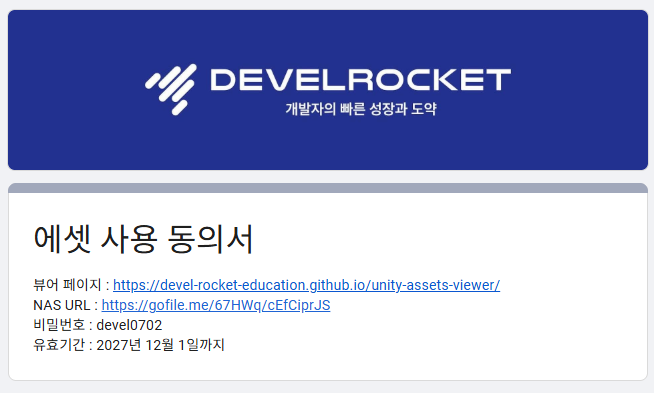

### 3.1. UI

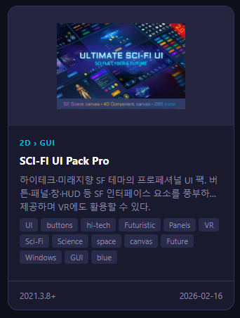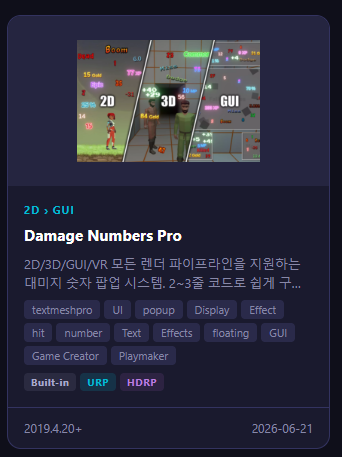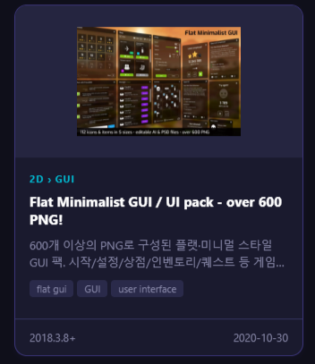

### 3.2. 이펙트

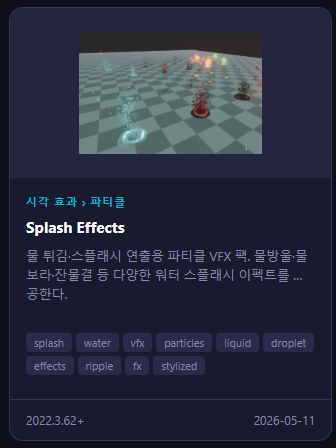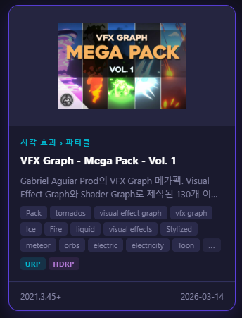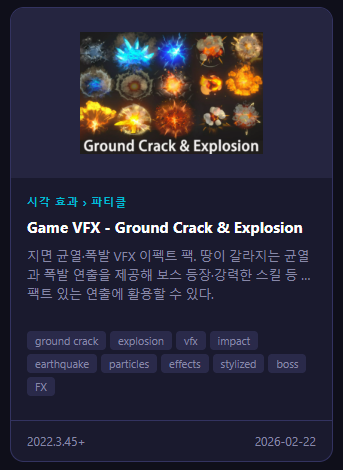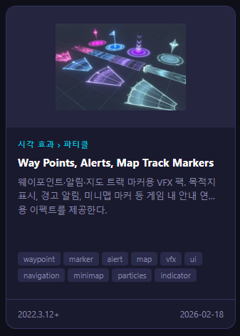

### 3.3. 플레이어 

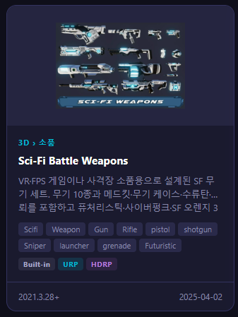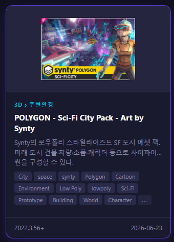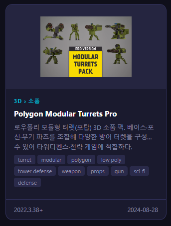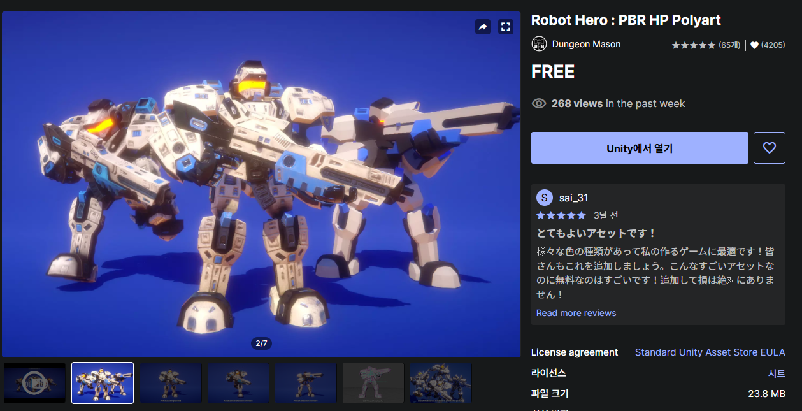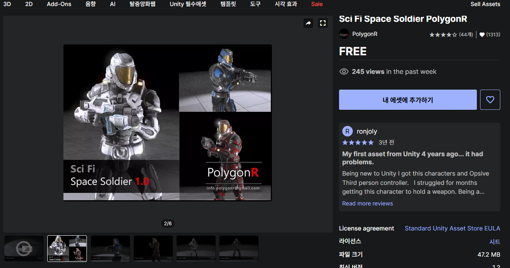

### 3.4. 사운드

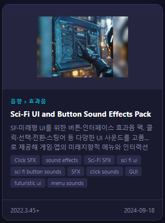

### 3.5. 적

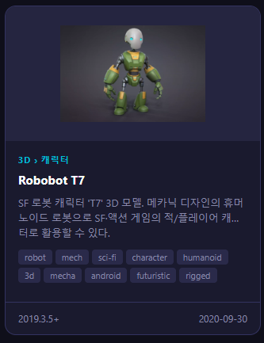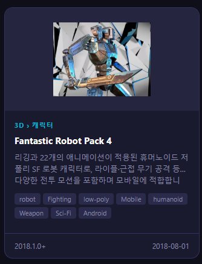

### 3.6. 맵 및 환경

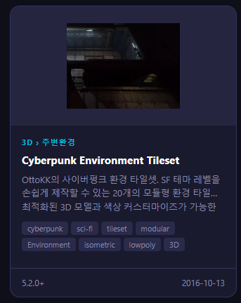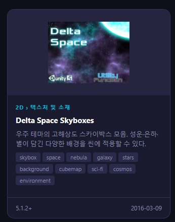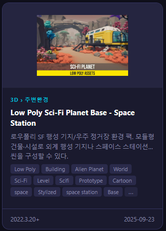

