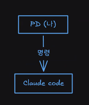
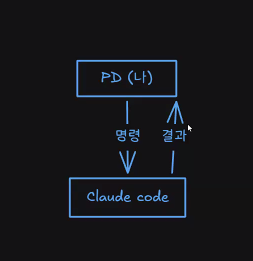
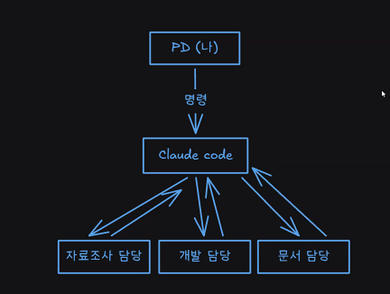
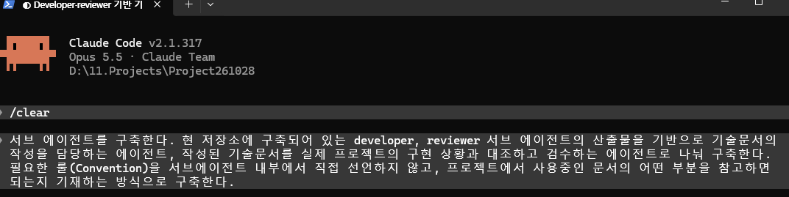
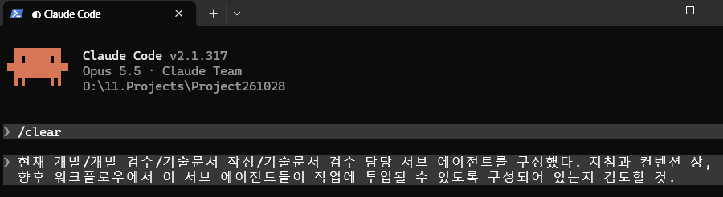
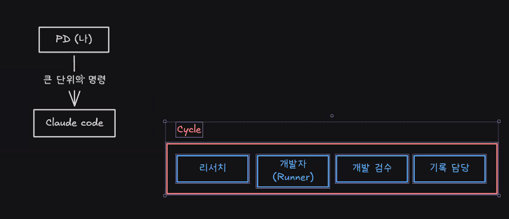
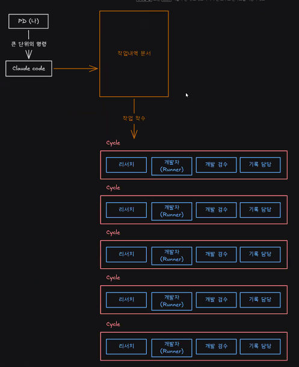
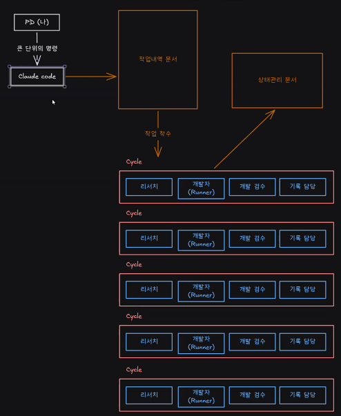

# 3D AI Programming(13) AI 프로그래밍 
## 1. 개인 프로젝트 확정 사항
### 1.1. 장르
- 턴제 전략 시뮬레이션
- 레퍼런스: 슈퍼로봇대전
- 핵심 시스템
  - 그리드 시스템: 이동 범위가 마름모 형태로 나타날 때 적이 막고 있으면 이동 범위를 제외해야 한다. 
  - 알고리즘: 승부볼 구간. 연출이 약하기 때문.
  - 공격 판정 거리는 그냥 띄워주면 된다.
  - 이동 시스템이 핵심인데 물 같은 곳에서 이동거리가 줄어야 한다.
  - 공격 영역은 필수지만 창작성은 달아도 됌.
  - 연출 X. 단, 체력바의 UI 적인 연출은 해야 함.

## 2. 들어가기 앞서
### 2.1. 전제조건
- 팀 프로젝트로 게임 제작을 진행한다.
- 나는 프로젝트 리더(PD)이다.
- 내가 원하는 인력(담당자)를 팀에 배치할 수 있다. 
- 룰이나 고정 업무 등을 내 마음대로 지정할 수 있다.
- 업무 프로세스(인력 단위)를 내 마음대로 지정할 수 있다.

### 2.2. 위 사항 기반 해야 할 것
- 어떤 인력들을 팀에 배치할지
  - 프로그래머 3 (자신 포함)
  - 아트 2
- 업무마다 어떤 프로세스로 어떤 인력들이 붙어서 진행하는지
  - 프로세스 흐름은 다음과 같이 진행된다: 
  
  (공통 흐름)   이슈 생성 → develop 브랜치로부터 사이드 브랜치 생성 → 가장 최신화된 Scene을 복제한 테스트 Scene에서 작업 준비 

  1. 프로그래머 
  (1.1. 시스템 및 사운드, 하위 서포팅)  
  (1.2. 기능 담당)  
  (1.3. UI 담당)  
  → 베이스 시스템 생성(1.1.) → 시스템 기반 기능 구현(1.2 메인, 1.1. 서브) → 기능 기반 UI 프레이밍 (1.3. 메인, 1.1., 1.2. 서브) → 구현 후 에디터 적용법 기술

  2. 아트 
  (2.1. 캐릭터)  
  (2.2. UI 및 맵)  
  → 전달받은 적용법대로 작업한 것들을 적용 

  (공통 흐름)   커밋 후 작업 브랜치에 푸쉬 → PR 요청 → 1.1의 검수 후 허가 발생 시 병합 → 병합 후, develop 브랜치에서 pull → 작업 브랜치 삭제.

- 고정적인 업무(작업일지 등)는 어떤 것이 있고, 어떤 상황에 해야 하는지
  - 작업 일지
  - 실시간 작업 공정을 나타내는 협업 툴이나 시트

## 3. 서브 에이전트
### 3.1. 개요
- 누굴 앉혀놓을 것인가이다.
- 그리고 업무를 쪼개서 구성원에게 나눠주는 형태이다. 
- 마일스톤을 찍고 검토한다. 
- 무조건 일이 직렬적으로 이뤄지진 않음.
- PD 단에서 할당이 이뤄지고 각 부서 책임자는 작업자에게 전달한다. 
- 이것까진 인간의 관점이다.

### 3.2. AI 환경
- 내 입장에서는 Claude Code에게 명령을 내릴 것이다.

- 좀 더 정확한 방식은 쌍방 관계인데 다음과 같다.

- 그런데 다른 방식으로 도입을 해보자는 아이디어도 낼 수 있다.
- Claude Code에게 명령을 내리는데 명령 단위가 작은 단위면 알아서 처리하고 결과물을 줄 것이다.
- 명령을 작은 단위로만 시키면 괜찮지만 상황에 따라 큰 단위도 수행해야 할 수 있다.
- AI를 쓰는 이유는 여러가지가 있지만 단일 업무 면보다는 여러개를 띄워두고 동시 수행과 병렬 구조로의 작업을 했기 때문이다.
- 작은 단위에서 수행하면 검수 횟수가 늘어나며 간단한 업무가 검토 시간이 늘어나며 내가 했던 것이 빨랐을 수도 있다.
- 완료 조건을 명확히 지정해주고 사양을 지정하여 큰 단위로 일을 시키는 경우가 있을 것이다. 
- 최종적으로 며칠씩 수행될 업무를 수행할 수 있다. 
- 만일 그렇게 장기적으로 가져가면, 세션 하나에 기억해야 할 데이터 자체가 기하급수적으로 늘어난다. 
- 따라서 환각이 늘어난다. 
- 근본적으로 해결할 수 있는 방법은 자신의 분야를 알고 행동하게끔 설계를 해야 한다.
- 하지만 Claude Code는 1인 회사기 때문에 시도해볼만한 것은 사람이 실제 일하는 것처럼 담당을 따로 둬야 한다는 것이다. 

### 3.3. AI 환경 구성
- 다음과 같이 역할을 나눠서 Claude Code 여러개를 돌릴 수 있으면 좋을 것이다.

- 키워드만 정확하게 조사해서 쌓이는 불필요한 데이터들을 제거하고 명령을 내려주면 돌려줄 것이다.
- 컨트롤 타워에서는 담당에게 구현을 요청하고 개발을 진행한 다음, 결과를 주면 된다. 
- 문서 컨벤션을 통해 작성 후 전달.
- 메인 컨트롤 타워는 필요 정보만 있으면 된다.
- 세부 정보는 담당자가 가지고 있어 담당을 하도록 할 수 있을 것 같다. 
- 이런 시스템은 내부적으로 좋은 기능이 존재한다. 
- 그게 바로 **서브 에이전트**이다.
- Claude Code를 켜서 보고 있는 것은 메인 에이전트인 셈.
- 스킬 등록할 때는 Claude Code에게 도움을 받았었다. 
- 중요한 것은 어떤 문서를 참고하란 식이다.
- 서브 에이전트도 크게 다를 것은 없다. 
- 맨 처음 들어가는 데이터들도 들어갈 것이다. 

### 3.4. 실사용 
- 일단, 서브 에이전트를 구축한다. 
- 개발 작업 담당과 개발 작업 산출물에 대한 검수자로 나눈다. 디테일한 내용을 직접 서브 에이전트에서 언급하기보다, 어떤 룰(Convention) 문서의 어떤 파트를 참고하면 되는지 정의한다.
- 시소 게임은 존재한다. 어떤 곳에 가중치를 둘 지에 대해.
- 서브 에이전트를 하나 더 만들어보자.

- 이제 서브 에이전트가 여러개고 토큰 소모량이 좀 되더라도 이런 식으로 생성하여 쓸 수 있다.
- 조금 더 효율을 중시한다면 이 중에서 병렬로 업무가 가능한 것은 무엇인지 볼 수 있어야 한다. 
- 그런데 독자적인 로컬로 구성하여 워크 트리라는 개념으로 병렬 운용이 가능하다. 
- 그래서 작업의 바운더리가 크게 겹치지만 않는다면 이동시키고 하는 것도 가능하다. 
- 대신 겹치지 않게 할 것인가는 사용자의 판단과 실력이다. 

### 3.5. 결과
- 일단 룰 자체가 바뀌어야 하므로 다음과 같이 진행한다.

- 토큰은 엄청 소모된다고 보면 된다. 
- 그래서 직렬적으로 공동 작업을 하는 편이 가성비적으로는 맞을 수 있다.
- 그러나 큰 단위에서는 빛을 발한다. 
- 클로드 메인 코드에서의 부하를 줄일 수 있다.
- 새로운 세션을 아예 새롭게 만들어서 별도의 명령을 내리는 형태이다 보니까 토큰 소모량과 맞바꾸는 형태인 셈.
- 다음은 해당 경우의 도식화이다.

- 꼬일 수 있는 여지가 있으므로 상태 관리 문서(현 사이클이 어떤가, bool 타입인 셈)를 업데이트를 실시간으로 관리하도록 하게 해준다면 된다.

- 이러한 아이디어가 바로 루프 엔지니어링이다.
- 하지만 어지간하면 쓰지 않는 것을 추천한다. 토큰 소모량이 엄청나기 때문.

## 4. hook
### 4.1. 개요
- 게임 개발 분야에서는 사실상 구현이 된 것을 실시간으로 테스트 하다보니 자동 업무 등록이 쓸모 있지는 않은 상황이다.
- 그럼에도 불구하고 언급을 해보겠다.

### 4.2. Claude 내부기능
- 내부적으로 기능 중에 SessionStart, UserPromptSubmit, PreToolUse, PostToolUse, Notification, Stop, SubagentStop 이렇게 나뉜다. 
- 세션 시작(혹은 이어질 때) 시, 미리 행동하도록 하는 것이 SessionStart.
- UserPromptSubmit은 사용자 요청 직후, Claude가 처리하기 직전에 사용됨.
- PreToolUse는 클로드가 도구(파일 수정, 명령 실행 등)를 쓰기 직전에 사용된다.
- PostToolUse는 도구 사용 성공 직후에 사용된다.
- Notification의 경우는 클로드가 알림을 보낼 때(권한 요청, 입력 대기) 사용된다.
- Stop은 클로드가 응답을 마칠 때 사용된다.
- SubagentStop은 서브 에이전트가 일을 마칠 때 사용된다. 
- 그런데 **유니티 상에서는 안 쓰고** 외부 툴에서나 아마 사용할 것.

## 5. 정리
- 지속적인 세팅 구축이 필요함.
- 본인만의 노하우가 필요한 단계
- 처음에는 고생하지 나중에는 딸깍이 되는 것. 
- 스타일을 담은 세팅을 찾아가도록 하자.