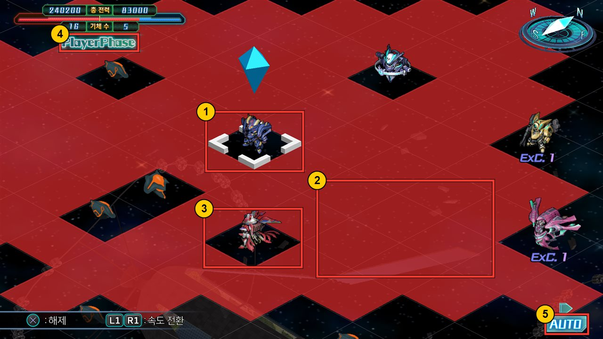
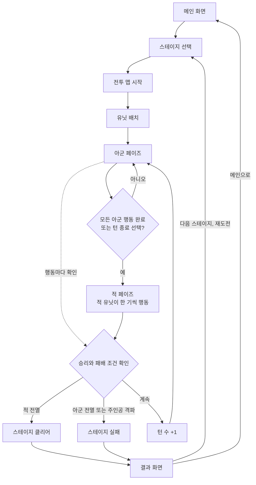
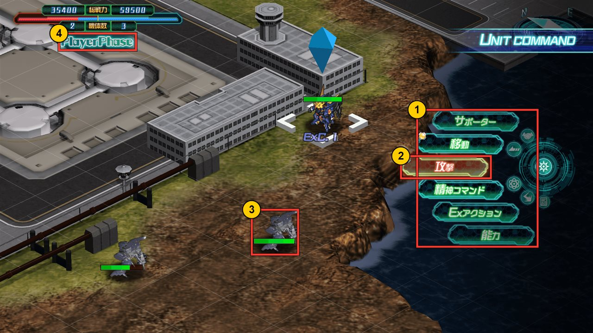
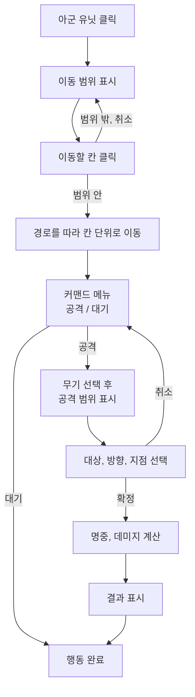
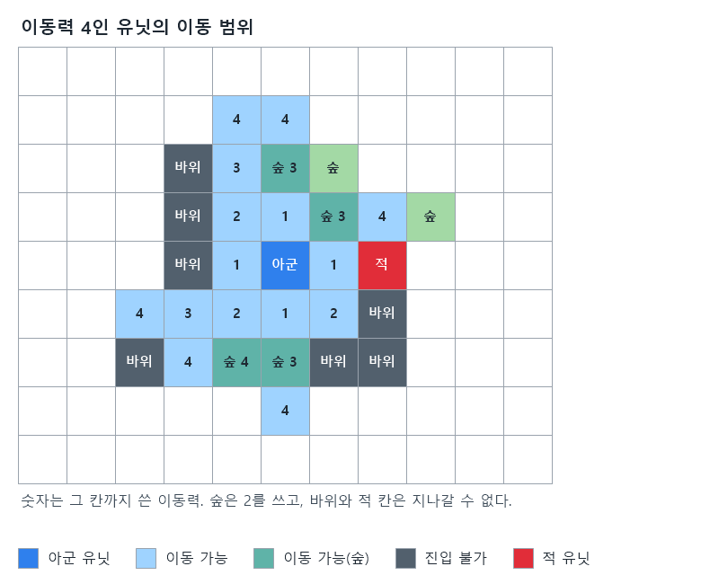
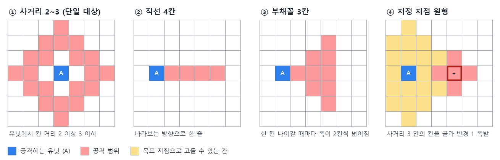
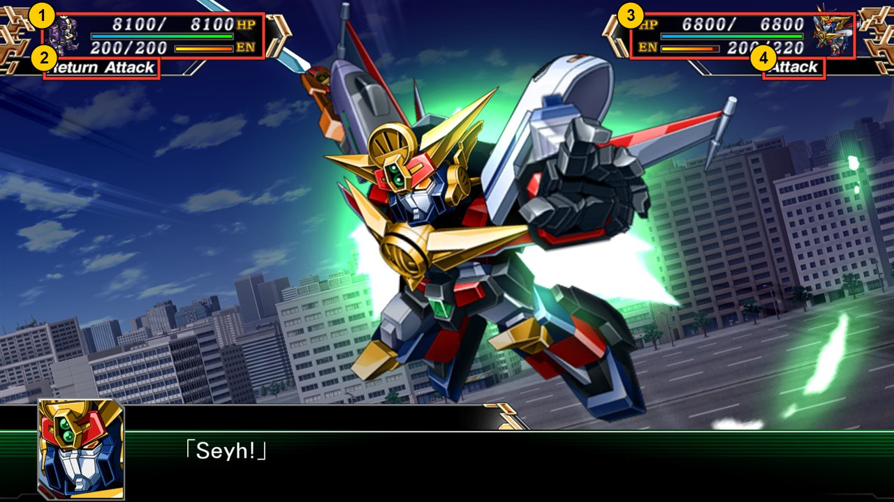
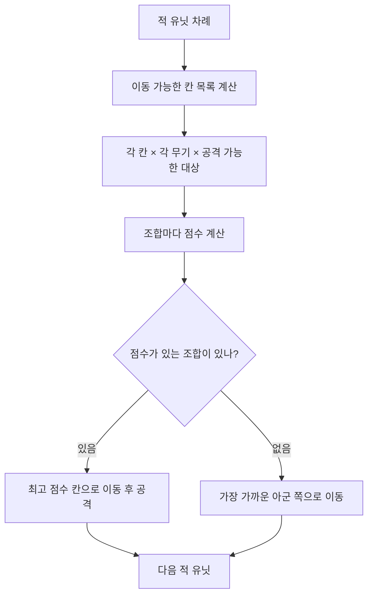

# 미션가이드 - 개인_그리드 턴제 전략

## 프로그램 소개

- **주제** : 슈퍼로봇대전 모작 - 사각 그리드 맵 위에서 유닛을 움직여 싸우는 턴제 전략 시뮬레이션 (PC, 싱글 플레이)
- **장르 특성** : 아군 페이즈에 내 유닛을 한 기씩 이동시키고 무기를 골라 공격한 뒤, 적 페이즈에 적 유닛이 스스로 판단해 움직이는 과정을 번갈아 반복하는 게임
- **핵심 조작 재미** : 어느 칸에 세우고 어떤 무기로 누구를 칠지 고르는 판단, 범위 무기로 여러 적을 한 번에 휩쓰는 쾌감, 적의 다음 수를 예상하고 진형을 짜는 재미
- **개발 규모** : 1인 개인 프로젝트 / Unity (2D, 3D 중 자유롭게 선택)
- **진행 기간** : 2026-11-06 ~ 2026-11-24 (13회)

> **모작 범위 안내** : 그리드 이동, 무기별 공격 범위, 페이즈 교대, 적 AI 구조를 따라 만드는 것이 목표다. 원작의 전투 애니메이션 컷신은 범위에 넣지 않는다. 맵 위에서 간단한 이동, 피격 표시와 데미지 숫자로 대체한다. 유닛의 외형과 명칭은 자유롭게 정해도 된다.

> **이 프로젝트에서 중요하게 보는 것** : 화려한 연출이 아니라 **이동 범위, 공격 범위, 적의 판단을 계산하는 알고리즘을 스스로 설계하고 적용해 보는 과정**이다. 알고리즘 교과목에서 배운 그래프와 탐색(BFS, 다익스트라)이 그대로 쓰이는 장르다. 각 기능 아래 `구상할 알고리즘` 에 풀어야 할 문제를 적어두었다. 정답 코드는 주지 않으니 직접 설계하고 시도한다.

1. 선택한 유닛. 흰 괄호 모양 커서가 지금 고른 칸을 표시하고, 위의 파란 마름모가 커서 위치를 알려준다.
2. 선택한 유닛을 기준으로 색이 칠해진 칸들. 범위는 이렇게 칸 단위로 맵 위에 겹쳐 보여준다.
3. 다른 유닛이 서 있는 칸. 색칠에서 빠져 있다. 범위를 계산할 때 이미 유닛이 있는 칸을 어떻게 다룰지 정해야 한다.
4. 현재 페이즈 표시 ( `PlayerPhase` ). 지금이 아군이 움직일 차례임을 알려준다.
5. AUTO 표시. 원작에는 아군을 자동으로 움직이는 기능도 있다. 적 AI를 잘 만들어 두면 같은 판단 로직으로 아군 자동 진행도 만들 수 있다(선택).

---

## 레퍼런스

- **슈퍼로봇대전 30 (2021, 반다이남코)** : 이 프로젝트의 기준 작품. 사각 그리드 맵, 아군 페이즈와 적 페이즈의 교대, 무기별 사거리와 범위 공격 구조를 따른다.
  - Steam : https://store.steampowered.com/app/898750/
  - 공식 사이트 시스템 소개 : https://srw30-thirty.suparobo.jp/kr/system/
  - 작품 소개 : 나무위키 - 슈퍼로봇대전 30
- 최신작 슈퍼로봇대전 Y(2025)는 칸이 없는 맵으로 바뀌었다. 영상이나 자료를 찾을 때 칸이 보이는 작품인지 확인한다.
- 시리즈 공통 시스템 자료 : 나무위키 - 슈퍼로봇대전 시리즈/시스템. 능력치, 지형, 무기 속성처럼 시리즈에 공통으로 쓰이는 규칙이 정리되어 있다

---

## 필수 유저 체험 및 기획 요소

- 유닛을 어느 칸에 세울지 고민하는 위치 선정의 재미 (지형, 적과의 거리, 아군과의 간격)
- 같은 유닛이라도 무기에 따라 공격할 수 있는 범위가 달라 생기는 무기 선택의 판단
- 범위 무기로 여러 적을 한 번에 맞힐 때의 한 방 쾌감
- 내 차례가 끝나면 적이 어떻게 움직일지 예상하고 대비하는 수 싸움
- 마지막 적을 쓰러뜨렸을 때의 클리어 성취감

---

## 게임 플로우

---

## 필요로 하는 기능

### 메인 화면 / 스테이지 선택

- 게임 타이틀, 게임 시작, 옵션, 종료 버튼
- 스테이지 선택 (스테이지 최소 2개). 각 스테이지의 승리 조건과 패배 조건을 함께 보여준다

### 카메라 / 시점 (필)

- 위에서 비스듬히 내려다보는 고정 각도 탑뷰 또는 쿼터뷰 카메라
- WASD 또는 마우스를 화면 가장자리로 가져가 맵을 이동한다. 맵 밖으로는 나가지 않는다
- 줌 인과 줌 아웃은 선택 기능이다

> **구상할 알고리즘**
>
> - 카메라 이동 범위를 맵 크기에 맞춰 제한하려면 맵 크기에서 어떤 값을 계산해야 하는가?
> - 적 페이즈에 행동하는 적에게 카메라를 자동으로 옮겨 주면 보기 편하다. 현재 위치에서 목표 위치까지 일정 시간에 걸쳐 옮기는 방법을 설계한다.

### 그리드 맵 (필)

- 사각 칸으로 이루어진 맵. 크기는 최소 10 x 10
- 지형 종류 최소 3가지

| 지형 예시 | 이동 비용 | 특성 예시 |
| --- | --- | --- |
| 평지 | 1 | 기본 |
| 숲 | 2 | 이 칸에 선 유닛은 회피율이 오른다 (선택) |
| 바위, 물 | 진입 불가 | 지나갈 수 없다 |

- 맵 구성(크기, 지형 배치, 유닛 초기 위치)은 **코드 밖 데이터**로 관리한다. 맵을 바꿀 때 코드를 열지 않아야 한다
- 마우스를 올린 칸을 강조하고, 클릭한 칸이 몇 번째 칸인지 알 수 있어야 한다

> **구상할 알고리즘**
>
> - 칸 좌표 `(x, y)` 와 월드 위치는 어떤 식으로 서로 바꾸는가? 칸 크기와 맵 원점을 기준으로 두 방향 변환식을 세워 본다.
> - 마우스로 클릭한 화면 위치를 어떤 변환을 거쳐 칸 좌표로 바꾸는가? 2D와 3D에서 필요한 과정이 어떻게 다른지 생각해 본다.
> - 맵 데이터 파일 한 줄 한 줄을 어떤 형식으로 쓰면 지형과 유닛 배치를 함께 담을 수 있는가?

### 유닛 (필) - 아군 3기 이상, 적 2종 이상

- 유닛 데이터 : 이름, HP, EN, 이동력, 무기 목록 (명중, 회피 같은 능력치는 필요한 만큼 추가)
- 무기 데이터 : 이름, 공격력, 최소, 최대 사거리, 범위 모양, EN 소모량
- 유닛과 무기 수치는 **코드 밖 데이터**로 분리한다
- 행동을 마친 유닛은 색을 어둡게 바꿔 이번 턴에 더 움직일 수 없음을 표시한다

1. 유닛 커맨드 메뉴. 유닛을 고르면 할 수 있는 행동 목록이 뜬다 (위에서부터 서포터, 이동, 공격, 정신 커맨드, Ex 액션, 능력).
2. 공격 커맨드. 이번 프로젝트는 이동, 공격, 대기 세 가지면 충분하다. 나머지는 선택이다.
3. 적 유닛 머리 위의 HP 바. 맵 화면에서도 남은 체력을 한눈에 볼 수 있다.
4. 현재 페이즈 표시 ( `PlayerPhase` ).

### 아군 페이즈 조작 (필)

유닛 한 기가 행동하는 순서는 아래와 같다.

- 이동을 마친 뒤 공격하기 전이라면 이동을 취소하고 원래 칸으로 되돌릴 수 있게 한다(선택)
- 아직 행동하지 않은 유닛이 남아 있어도 턴 종료 버튼으로 페이즈를 넘길 수 있다

### 이동 범위 (필)

- 유닛의 이동력 안에서 갈 수 있는 칸을 모두 표시한다
- 지형마다 이동 비용이 다르고, 진입 불가 칸과 적 유닛이 있는 칸은 지나갈 수 없다
- 아군이 있는 칸은 지나갈 수는 있지만 멈출 수는 없게 한다
- 목적지를 고르면 실제로 지나갈 경로를 따라 한 칸씩 이동한다. 장애물을 뚫고 직선으로 미끄러지면 안 된다

**이동력 4인 유닛의 이동 범위**

숫자는 그 칸까지 쓴 이동력. 숲은 2를 쓰고, 바위와 적 칸은 지나갈 수 없다.

- 아군 유닛 / 이동 가능 / 이동 가능(숲) / 진입 불가 / 적 유닛

이동력 4인 아군 유닛의 이동 범위를 그린 도해다. 칸 안의 숫자는 그 칸에 도착하기까지 쓴 이동력이다. 숲은 2를 쓰기 때문에 같은 거리라도 숲을 지나면 더 적게 나아간다. 오른쪽 위의 숲 칸은 거리로는 가깝지만 도착하려면 이동력 5가 필요해 범위에서 빠졌다.

> **구상할 알고리즘**
>
> - 알고리즘 교과목의 BFS를 떠올려 본다. 모든 칸의 비용이 1이라면 BFS만으로 범위를 구할 수 있다. 그런데 숲처럼 비용이 다른 칸이 섞이면 BFS가 틀린 답을 내는 경우가 생긴다. 어떤 경우인지 찾아보고, 다익스트라로 바꾸면 무엇이 달라지는지 비교한다.
> - 탐색하면서 "이 칸에 어느 칸에서 왔는가"를 기록해 두면 목적지에서 출발점까지 거꾸로 따라가 경로를 만들 수 있다. 무엇을 어떤 자료구조에 기록할 것인가?
> - 아군 칸은 "지나갈 수 있지만 멈출 수 없다"는 규칙을 탐색 중 어디에서 처리해야 하는가? 탐색에서 아예 빼는 것과 결과에서만 빼는 것의 차이를 생각해 본다.

### 무기와 공격 범위 (필) - 유닛당 무기 2종 이상, 전체 중 범위 무기 1종 이상

- **단일 대상 무기** : 최소~최대 사거리 안의 적 한 기를 고른다. 사거리는 칸 거리(상하좌우로 몇 칸 떨어졌는가)로 잰다
  - 예 : 근접 무기는 사거리 1~1, 사격 무기는 사거리 2~4
- **범위 무기** : 정해진 모양 안의 모든 대상에게 피해를 준다. 아래 모양 중 1가지 이상을 구현한다
- 무기를 쓰면 EN이 줄어들고, EN이 모자란 무기는 고를 수 없다

무기 범위 모양을 칸으로 그린 도해다.

1. 사거리 2~3 단일 대상 무기. 바로 옆 칸(거리 1)은 사거리 밖이라 공격할 수 없다. 원거리 무기의 약점을 이렇게 만든다.
2. 직선 범위 무기. 유닛이 바라보는 방향으로 한 줄을 공격한다. 방향 4가지 중 하나를 골라 쏜다.
3. 부채꼴 범위 무기. 한 칸 나아갈 때마다 폭이 2칸씩 넓어진다.
4. 지정 지점 원형 범위 무기. 노란 칸 중 한 곳(빨간 테두리)을 골라 그 칸을 중심으로 폭발한다. 이 모양은 쏘는 유닛 자신은 맞지 않는다.

> **구상할 알고리즘**
>
> - "칸 거리"를 두 칸 좌표로 어떻게 계산하는가? 이 거리 하나로 ① 모양 전체를 만들 수 있는지 확인한다.
> - ②와 ③을 오른쪽 방향 하나만 먼저 만든 뒤, 같은 모양을 위, 아래, 왼쪽으로 돌리려면 칸 좌표를 어떻게 바꾸면 되는가? 모양을 "유닛 기준 상대 좌표 목록"으로 저장하면 회전이 쉬워진다.
> - 범위가 맵 밖으로 나가거나 진입 불가 칸에 걸칠 때 어떻게 처리할 것인가? 직선 무기가 바위에 막혀야 하는지도 직접 정한다.
> - 범위 무기에 아군이 맞을지 말지를 규칙으로 정하고, 맞는 경우에는 미리 경고를 띄운다.

### 전투 계산 (필)

- 공격하면 **명중 여부**를 판정하고, 맞으면 **데미지**를 준다. HP가 0이 된 유닛은 맵에서 사라진다
- 공격 전에 **예상 명중률과 예상 데미지**를 보여주는 창을 띄운다
- 계산식은 직접 만든다. 공격력, 지형 보너스, 거리 같은 값 중 무엇을 넣을지 정하고 식을 문서로 남긴다
- **반격(선택)** : 공격받은 유닛이 살아 있고 공격자가 자기 무기 사거리 안에 있으면 반격한다

시리즈 전작인 슈퍼로봇대전 V의 전투 화면이다. 컷신 연출은 이번 범위가 아니지만 화면 위쪽의 정보 구성은 참고할 만하다.

1. 반격하는 쪽의 HP와 EN. 숫자와 막대로 함께 보여준다.
2. 행동 이름 `Return Attack` (반격). 공격받은 유닛이 되받아친다.
3. 먼저 공격한 쪽의 HP와 EN. EN이 `200/220` 으로 줄어 있다. 무기를 쓰면 EN을 소모한다.
4. 행동 이름 `Attack` (공격).

> **구상할 알고리즘**
>
> - 명중률을 퍼센트로 정했다면 실제 명중 여부는 어떻게 뽑는가? 같은 판을 다시 해도 결과가 같게 하려면 난수를 어떻게 다뤄야 하는가(선택)?
> - 데미지 식에 들어가는 값이 늘어나도 식을 한곳에서만 고치도록 계산 부분을 어떻게 분리할 것인가?

### 적 AI (필) - 행동 유형 2종 이상

- 적 페이즈에는 적 유닛이 한 기씩 순서대로 행동한다. 각 행동이 화면에서 보이도록 사이사이에 짧은 대기를 둔다
- 적도 아군과 똑같은 이동 범위, 공격 범위 규칙을 따른다

**행동 유형 예시**

| 유형 | 행동 |
| --- | --- |
| 공격형 | 갈 수 있는 칸 중에서 가장 좋은 공격을 할 수 있는 칸으로 가서 공격한다. 공격할 수 없으면 가장 가까운 아군에게 다가간다 |
| 대기형 | 아군이 일정 거리 안에 들어오기 전까지 움직이지 않는다 |
| 고정형 (보스 등) | 이동하지 않고 사거리 안에 들어온 아군만 공격한다 |

> **구상할 알고리즘**
>
> - "가장 좋은 공격"을 점수로 바꾸는 식을 세운다. 예상 데미지, 대상을 쓰러뜨릴 수 있는가, 공격 후 반격을 받는가 중 무엇을 얼마나 중요하게 볼지 정한다.
> - 이동 가능한 칸이 30개, 무기가 2개, 대상이 5기라면 조합은 몇 개인가? 칸마다 모든 대상을 다 검사하지 않고 줄일 방법이 있는가?
> - "가장 가까운 아군 쪽으로 이동"할 때 직선 거리로 고르면 바위 너머의 아군을 향해 막힌 길로 갈 수 있다. 실제로 걸어갈 수 있는 거리로 고르려면 무엇을 계산해야 하는가?
> - 유형이 늘어나도 적 페이즈 진행 코드는 그대로 두려면 "판단 방법"을 어떻게 분리할 것인가?

### 승리와 패배 조건 (필)

- 승리 : 적 전멸 (스테이지에 따라 "보스 격파"로 바꿀 수 있게 하면 좋다)
- 패배 : 아군 전멸 또는 주인공 유닛 격파
- 턴 수 제한(선택) : 정해진 턴 안에 이기지 못하면 패배

### 인게임 UI (필)

- 현재 턴 수와 페이즈 표시. 페이즈가 바뀔 때 화면 가운데에 크게 띄운다
- 칸에 마우스를 올리면 그 칸의 지형, 서 있는 유닛의 이름, HP, EN을 보여주는 정보 창
- 커맨드 메뉴, 무기 선택 목록(사거리, 공격력, EN 소모 표시), 전투 예측 창
- 턴 종료 버튼, 일시정지(ESC) 메뉴 : 재개 / 메인 화면
- 적 유닛을 클릭하면 그 적의 이동 범위와 공격 범위를 보여준다(선택). 수 싸움이 훨씬 쉬워진다

### 결과 화면 (필)

- 클리어 / 실패 표시
- 걸린 턴 수, 격파 수, 잃은 아군 수
- 다음 스테이지, 재도전 / 메인 화면 버튼

### 옵션

- BGM / SFX 볼륨 조절

---

## 필요로 하는 Asset

- 에셋은 Asset Store 무료 에셋 또는 학원 제공 에셋을 사용한다
- 학원 제공 에셋을 쓸 때는 외부로 무분별하게 유출되지 않도록 주의한다. 에셋 원본 파일을 공개 GitHub 저장소에 올리거나 다른 사람에게 전달하지 않는다
- 유닛, 지형 그래픽(모델 또는 스프라이트)은 위 에셋으로 구성한다. 기본 도형(Primitive)은 기능을 먼저 만들어 보는 개발 초기에만 임시로 쓰고, 최종 빌드에서는 에셋으로 교체한다. 아군과 적, 유닛 종류가 맵 위에서 한눈에 구분되어야 한다
- 그리드 칸 강조(이동 범위, 공격 범위, 마우스 위치)는 칸 위에 반투명 판을 깔아 색을 바꾸는 정도면 된다
- 이펙트는 위 에셋 중에서 골라 쓴다. 파티클 시스템과 셰이더는 이후 교과목에서 배우므로 직접 만들지 않는다. 받은 이펙트를 알맞은 칸과 시점에 생성하는 데 집중한다
- 필요한 이펙트 예시 : 피격, 폭발(범위 무기), 유닛 격파

---

## 활용해야 하는 기술

- 이 장르는 칸 단위로 직접 길을 찾으므로 NavMesh를 쓰지 않는다
- **그래프 탐색 (BFS, 다익스트라)** : 이동 범위와 경로, 적 AI의 실제 이동 거리 계산
- **상태 패턴** : 페이즈(아군, 적)와 조작 단계(유닛 선택, 이동, 커맨드, 대상 선택 순)를 상태로 나눈다
- **ScriptableObject** : 유닛, 무기, 지형 데이터를 분리한다
- **CSV Parse 또는 JsonUtility** : 맵 데이터를 파일로 관리한다

---

## 스테이지 구성 예시

| 스테이지 | 승리 조건 | 적 구성 | 특이사항 |
| --- | --- | --- | --- |
| 1 | 적 전멸 | 공격형 3~4기 | 지형이 단순한 작은 맵. 이동, 공격, 대기 조작과 페이즈 교대를 익힌다 |
| 2 | 적 전멸 | 공격형 + 대기형 | 숲과 바위로 길이 갈라진 맵. 지형 비용과 범위 무기 활용을 유도한다 |
| 3 | 보스 격파 | 고정형 보스 + 호위 적 | 보스 사거리 밖에서 호위부터 정리하도록 배치한다 |
